# Laporan Praktikum Modul 5 — Komunikasi Data & Jaringan Komputer 2026

**Operation Geofront** · Kelompok **K-51** · Group A

| Nama | NRP | Bagian |
|---|---|---|
| Arrumanta Ekna Luhkinasih | 5027251044 | Soal 1–5, 11–15 |
| Muhammad Hugo Rayandra | 5027251076 | Soal 6–10, 16–20 |

---

## Topologi

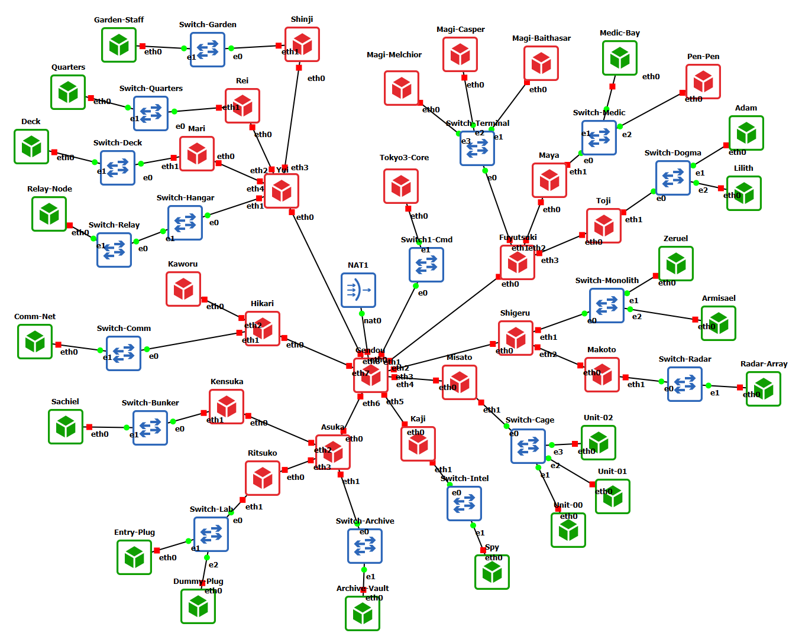

- 17 router (image `ardhptr21/debinet`), 17 switch, 1 NAT (NAT1), 25 node.
- Konvensi interface router: **eth0 = ke router atas (parent) / NAT1**, **eth1 = LAN switch sendiri**, **eth2 dst. = router anak**.

Struktur pohon router:

```
Gendou ── NAT1 (eth0), Switch-Cmd (eth1)
├── eth2 Fuyutsuki ── Switch-Terminal
│   ├── eth2 Maya ── Switch-Medic
│   └── eth3 Toji ── Switch-Dogma
├── eth3 Shigeru ── Switch-Monolith
│   └── eth2 Makoto ── Switch-Radar
├── eth4 Misato ── Switch-Cage
├── eth5 Kaji ── Switch-Intel
├── eth6 Asuka ── Switch-Archive
│   ├── eth2 Kensuke ── Switch-Bunker
│   └── eth3 Ritsuko ── Switch-Lab
├── eth7 Hikari ── Switch-Comm
│   └── eth2 Kaworu ── Switch-Relay
└── eth8 Yui ── Switch-Hangar
    ├── eth2 Rei ── Switch-Quarters
    ├── eth3 Shinji ── Switch-Garden
    └── eth4 Mari ── Switch-Dock
```

---

## Soal 1 — Markas tanpa peta (VLSM)

Prefix kelompok: **10.89.0.0**. Total kebutuhan 1196 alamat, sehingga seluruh alokasi muat di **10.89.0.0/21** (terpakai sampai 10.89.4.171).

**Aturan yang dipakai**
- Kebutuhan IP per LAN = jumlah host + 1 gateway + 2 (network & broadcast), lalu dibulatkan ke pangkat 2 terkecil yang muat.
- Link antar-router = /30 (2 router + network + broadcast).
- Urutan alokasi: ukuran terbesar dulu. Kalau ukuran sama: LAN dulu, lalu link, lalu urutan tabel.
- Urutan antar link (tidak ada di tabel soal) mengikuti nomor tabel LAN milik router anak (Rei=1, Hikari=2, Yui=3, …).
- Gateway = IP usable pertama. Node diberi IP berikutnya sesuai urutan nama di gambar (kiri ke kanan).

### Contoh perhitungan satu subnet — Switch-Bunker (Kensuke)

- Host: Sachiel = 55, gateway = 1 → 56 alamat usable dibutuhkan.
- Ditambah network + broadcast → 58 alamat.
- Pangkat 2 terkecil ≥ 58 adalah 64 = 2⁶ → prefix = 32 − 6 = **/26** (netmask 255.255.255.192).
- Alamat sebelumnya yang sudah dipakai berakhir di 10.89.3.127 (Hangar /25), maka Bunker = **10.89.3.128/26**.
- Network 10.89.3.128, gateway 10.89.3.129, Sachiel 10.89.3.130, broadcast 10.89.3.191.
- Usable 62, terpakai 56, sisa 6.

### Tabel LAN

| No | Subnet (gateway) | Network | Prefix | Netmask | Gateway | IP node | Broadcast | Terpakai | Sisa |
|---|---|---|---|---|---|---|---|---|---|
| 1 | Quarters (Rei) | 10.89.0.0 | /23 | 255.255.254.0 | 10.89.0.1 | Quarters .0.2 | 10.89.1.255 | 501 | 9 |
| 2 | Comm (Hikari) | 10.89.2.0 | /24 | 255.255.255.0 | 10.89.2.1 | Comm-Net .2.2 | 10.89.2.255 | 201 | 53 |
| 3 | Hangar (Yui) | 10.89.3.0 | /25 | 255.255.255.128 | 10.89.3.1 | Hangar-Crew .3.2 | 10.89.3.127 | 101 | 25 |
| 4 | Bunker (Kensuke) | 10.89.3.128 | /26 | 255.255.255.192 | 10.89.3.129 | Sachiel .3.130 | 10.89.3.191 | 56 | 6 |
| 5 | Medic (Maya) | 10.89.3.192 | /27 | 255.255.255.224 | 10.89.3.193 | Medic-Bay .194, Pen-Pen .195 | 10.89.3.223 | 27 | 3 |
| 6 | Relay (Kaworu) | 10.89.3.224 | /27 | 255.255.255.224 | 10.89.3.225 | Relay-Node .226 | 10.89.3.255 | 26 | 4 |
| 7 | Garden (Shinji) | 10.89.4.0 | /27 | 255.255.255.224 | 10.89.4.1 | Garden-Staff .4.2 | 10.89.4.31 | 15 | 15 |
| 8 | Dock (Mari) | 10.89.4.32 | /28 | 255.255.255.240 | 10.89.4.33 | Dock-Crew .34 | 10.89.4.47 | 13 | 1 |
| 9 | Lab (Ritsuko) | 10.89.4.48 | /29 | 255.255.255.248 | 10.89.4.49 | Entry-Plug .50, Dummy-Plug .51 | 10.89.4.55 | 6 | 0 |
| 10 | Terminal (Fuyutsuki) | 10.89.4.56 | /29 | 255.255.255.248 | 10.89.4.57 | Casper .58, Balthasar .59, Melchior .60 | 10.89.4.63 | 4 | 2 |
| 11 | Cage (Misato) | 10.89.4.64 | /29 | 255.255.255.248 | 10.89.4.65 | Unit-01 .66, Unit-02 .67, Unit-00 .68 | 10.89.4.71 | 4 | 2 |
| 12 | Dogma (Toji) | 10.89.4.72 | /29 | 255.255.255.248 | 10.89.4.73 | Lilith .74, Adam .75 | 10.89.4.79 | 3 | 3 |
| 13 | Monolith (Shigeru) | 10.89.4.80 | /29 | 255.255.255.248 | 10.89.4.81 | Zeruel .82, Armisael .83 | 10.89.4.87 | 3 | 3 |
| 14 | Radar (Makoto) | 10.89.4.88 | /29 | 255.255.255.248 | 10.89.4.89 | Radar-Array .90 | 10.89.4.95 | 5 | 1 |
| 15 | Archive (Asuka) | 10.89.4.96 | /30 | 255.255.255.252 | 10.89.4.97 | Archive-Vault .98 | 10.89.4.99 | 2 | 0 |
| 16 | Intel (Kaji) | 10.89.4.100 | /30 | 255.255.255.252 | 10.89.4.101 | Spy .102 | 10.89.4.103 | 2 | 0 |
| 17 | Cmd (Gendou) | 10.89.4.104 | /30 | 255.255.255.252 | 10.89.4.105 | Tokyo3-Core .106 | 10.89.4.107 | 2 | 0 |

> Terpakai = jumlah host + gateway. Sisa = usable − terpakai.

### Tabel link antar-router (/30)

| No | Link | Network | IP parent | IP child | Broadcast |
|---|---|---|---|---|---|
| L1 | Yui – Rei | 10.89.4.108/30 | .109 | .110 | .111 |
| L2 | Gendou – Hikari | 10.89.4.112/30 | .113 | .114 | .115 |
| L3 | Gendou – Yui | 10.89.4.116/30 | .117 | .118 | .119 |
| L4 | Asuka – Kensuke | 10.89.4.120/30 | .121 | .122 | .123 |
| L5 | Fuyutsuki – Maya | 10.89.4.124/30 | .125 | .126 | .127 |
| L6 | Hikari – Kaworu | 10.89.4.128/30 | .129 | .130 | .131 |
| L7 | Yui – Shinji | 10.89.4.132/30 | .133 | .134 | .135 |
| L8 | Yui – Mari | 10.89.4.136/30 | .137 | .138 | .139 |
| L9 | Asuka – Ritsuko | 10.89.4.140/30 | .141 | .142 | .143 |
| L10 | Gendou – Fuyutsuki | 10.89.4.144/30 | .145 | .146 | .147 |
| L11 | Gendou – Misato | 10.89.4.148/30 | .149 | .150 | .151 |
| L12 | Fuyutsuki – Toji | 10.89.4.152/30 | .153 | .154 | .155 |
| L13 | Gendou – Shigeru | 10.89.4.156/30 | .157 | .158 | .159 |
| L14 | Shigeru – Makoto | 10.89.4.160/30 | .161 | .162 | .163 |
| L15 | Gendou – Asuka | 10.89.4.164/30 | .165 | .166 | .167 |
| L16 | Gendou – Kaji | 10.89.4.168/30 | .169 | .170 | .171 |

Semua link: terpakai 2, sisa 0.

### Pohon pembagian IP

Subnet yang dilingkari merah adalah jalur **Dummy-Plug → Armisael**:
Lab `10.89.4.48/29` → L9 Asuka–Ritsuko `10.89.4.140/30` → L15 Gendou–Asuka `10.89.4.164/30` → L13 Gendou–Shigeru `10.89.4.156/30` → Monolith `10.89.4.80/29`.

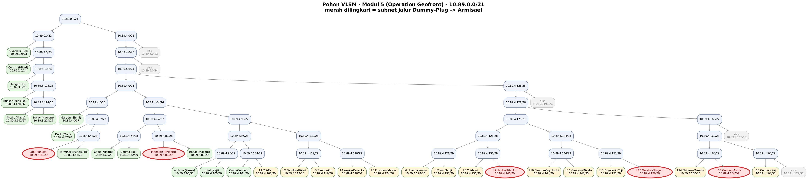

---

## Soal 2 — Geofront gelap gulita (IP interface + IP forwarding)

Semua router dikonfigurasi lewat **Edit network configuration** di GNS3 (tersimpan di `/etc/network/interfaces` dan otomatis diterapkan saat node start). Gendou eth0 memakai **DHCP** dari NAT1. IP forwarding diaktifkan lewat baris `up echo 1 > /proc/sys/net/ipv4/ip_forward` pada eth0 tiap router.

### Contoh konfigurasi — Gendou

```
auto eth0
iface eth0 inet dhcp
    up echo 1 > /proc/sys/net/ipv4/ip_forward

auto eth1
iface eth1 inet static
    address 10.89.4.105
    netmask 255.255.255.252

auto eth2
iface eth2 inet static
    address 10.89.4.145
    netmask 255.255.255.252

auto eth3
iface eth3 inet static
    address 10.89.4.157
    netmask 255.255.255.252

auto eth4
iface eth4 inet static
    address 10.89.4.149
    netmask 255.255.255.252

auto eth5
iface eth5 inet static
    address 10.89.4.169
    netmask 255.255.255.252

auto eth6
iface eth6 inet static
    address 10.89.4.165
    netmask 255.255.255.252

auto eth7
iface eth7 inet static
    address 10.89.4.113
    netmask 255.255.255.252

auto eth8
iface eth8 inet static
    address 10.89.4.117
    netmask 255.255.255.252
```

### Contoh konfigurasi — router cabang (Fuyutsuki)

```
auto eth0
iface eth0 inet static
    address 10.89.4.146
    netmask 255.255.255.252
    up echo 1 > /proc/sys/net/ipv4/ip_forward

auto eth1
iface eth1 inet static
    address 10.89.4.57
    netmask 255.255.255.248

auto eth2
iface eth2 inet static
    address 10.89.4.125
    netmask 255.255.255.252

auto eth3
iface eth3 inet static
    address 10.89.4.153
    netmask 255.255.255.252
```

Router lain mengikuti pola yang sama (eth0 = IP child pada link ke parent, eth1 = gateway LAN, eth2+ = IP parent pada link ke anak), sesuai tabel soal 1.

### Ringkasan IP per router

| Router | eth0 | eth1 | eth2 | eth3 | eth4–eth8 |
|---|---|---|---|---|---|
| Gendou | DHCP (192.168.122.16/24) | 10.89.4.105/30 | 10.89.4.145/30 | 10.89.4.157/30 | .149, .169, .165, .113, .117 (/30) |
| Fuyutsuki | 10.89.4.146/30 | 10.89.4.57/29 | 10.89.4.125/30 | 10.89.4.153/30 | – |
| Maya | 10.89.4.126/30 | 10.89.3.193/27 | – | – | – |
| Toji | 10.89.4.154/30 | 10.89.4.73/29 | – | – | – |
| Shigeru | 10.89.4.158/30 | 10.89.4.81/29 | 10.89.4.161/30 | – | – |
| Makoto | 10.89.4.162/30 | 10.89.4.89/29 | – | – | – |
| Misato | 10.89.4.150/30 | 10.89.4.65/29 | – | – | – |
| Kaji | 10.89.4.170/30 | 10.89.4.101/30 | – | – | – |
| Asuka | 10.89.4.166/30 | 10.89.4.97/30 | 10.89.4.121/30 | 10.89.4.141/30 | – |
| Kensuke | 10.89.4.122/30 | 10.89.3.129/26 | – | – | – |
| Ritsuko | 10.89.4.142/30 | 10.89.4.49/29 | – | – | – |
| Hikari | 10.89.4.114/30 | 10.89.2.1/24 | 10.89.4.129/30 | – | – |
| Kaworu | 10.89.4.130/30 | 10.89.3.225/27 | – | – | – |
| Yui | 10.89.4.118/30 | 10.89.3.1/25 | 10.89.4.109/30 | 10.89.4.133/30 | eth4 10.89.4.137/30 |
| Rei | 10.89.4.110/30 | 10.89.0.1/23 | – | – | – |
| Shinji | 10.89.4.134/30 | 10.89.4.1/27 | – | – | – |
| Mari | 10.89.4.138/30 | 10.89.4.33/28 | – | – | – |

### Bukti `ip -br a` dan IP forwarding

Command yang dijalankan di tiap router:

```bash
hostname; ip -br a; echo "ip_forward = $(cat /proc/sys/net/ipv4/ip_forward)"
```

| | | |
|---|---|---|
| Gendou 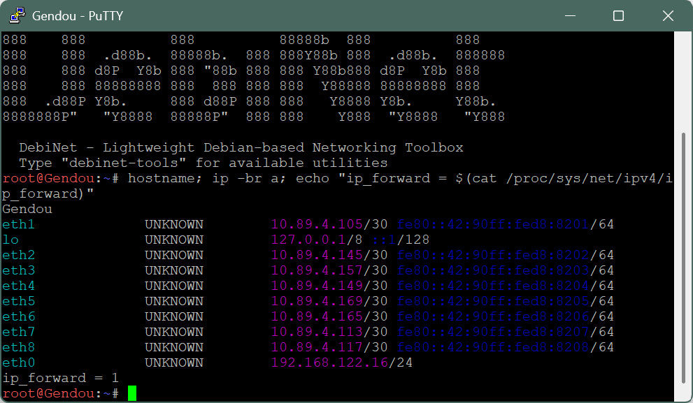 | Fuyutsuki 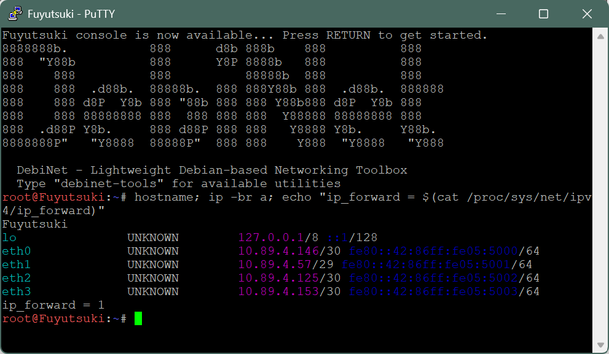 | Maya  |
| Toji  | Shigeru  | Makoto  |
| Misato  | Kaji  | Asuka  |
| Ritsuko  | Kensuke 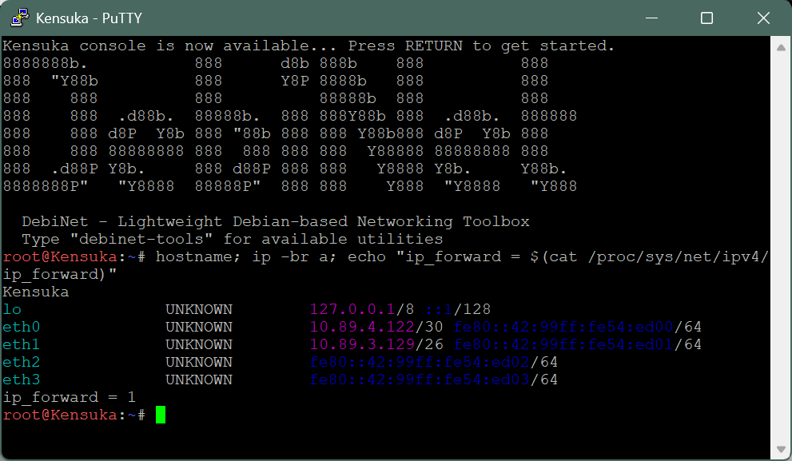 | Hikari  |
| Kaworu  | Yui 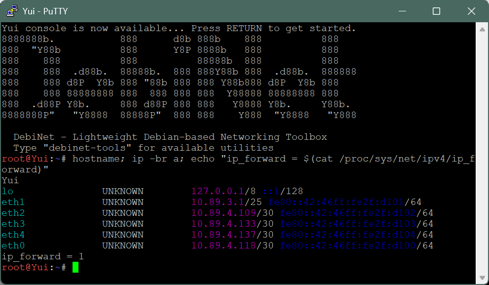 | Rei  |
| Shinji 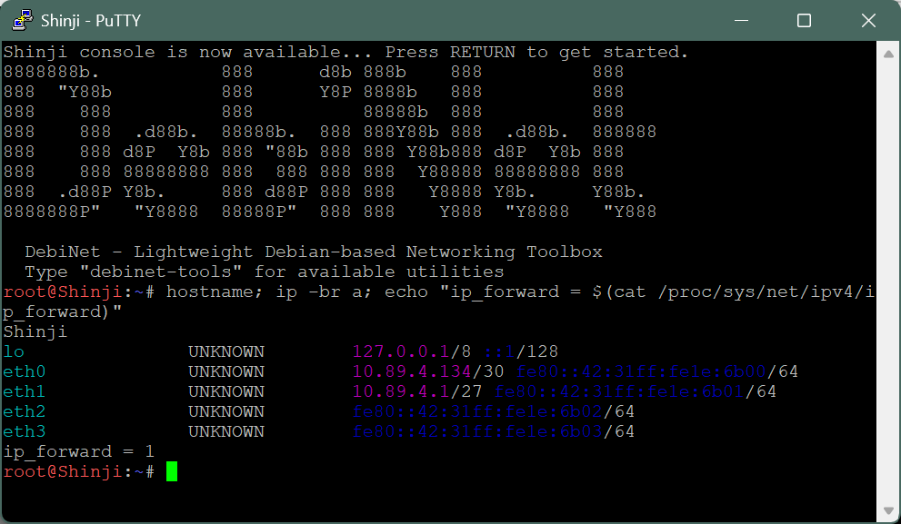 | Mari  | |

Hasil: semua interface terpasang sesuai tabel, Gendou eth0 mendapat `192.168.122.16/24` dari DHCP NAT1, dan `ip_forward = 1` di seluruh router.

### Bukti ping dua ujung tiap link router-ke-router

Dari router parent ke semua router anak, contoh di Gendou:

```bash
echo "### $(hostname)"; for ip in 10.89.4.146 10.89.4.158 10.89.4.150 10.89.4.170 10.89.4.166 10.89.4.114 10.89.4.118; do echo "== ping $ip =="; ping -c2 -W1 $ip | tail -2; done
```

| Router | Target |
|---|---|
| Gendou | 10.89.4.146, .158, .150, .170, .166, .114, .118 |
| Fuyutsuki | 10.89.4.126, .154 |
| Shigeru | 10.89.4.162 |
| Asuka | 10.89.4.122, .142 |
| Hikari | 10.89.4.130 |
| Yui | 10.89.4.110, .134, .138 |

Dari tiap router anak ke parent-nya (IP parent = IP eth0 sendiri − 1):

```bash
MY=$(ip -4 -o addr show eth0 | awk '{print $4}' | cut -d/ -f1); P=${MY%.*}.$(( ${MY##*.} - 1 )); echo "### $(hostname) ($MY) -> parent $P"; ping -c2 -W1 $P | tail -2
```

Hasil: **ke-16 link berhasil di-ping dari kedua ujungnya dengan 0% packet loss.** Router parent (Gendou, Fuyutsuki, Shigeru, Asuka, Hikari, Yui) menjalankan kedua command, sedangkan router ujung hanya menjalankan ping ke parent.

| | | |
|---|---|---|
| Gendou 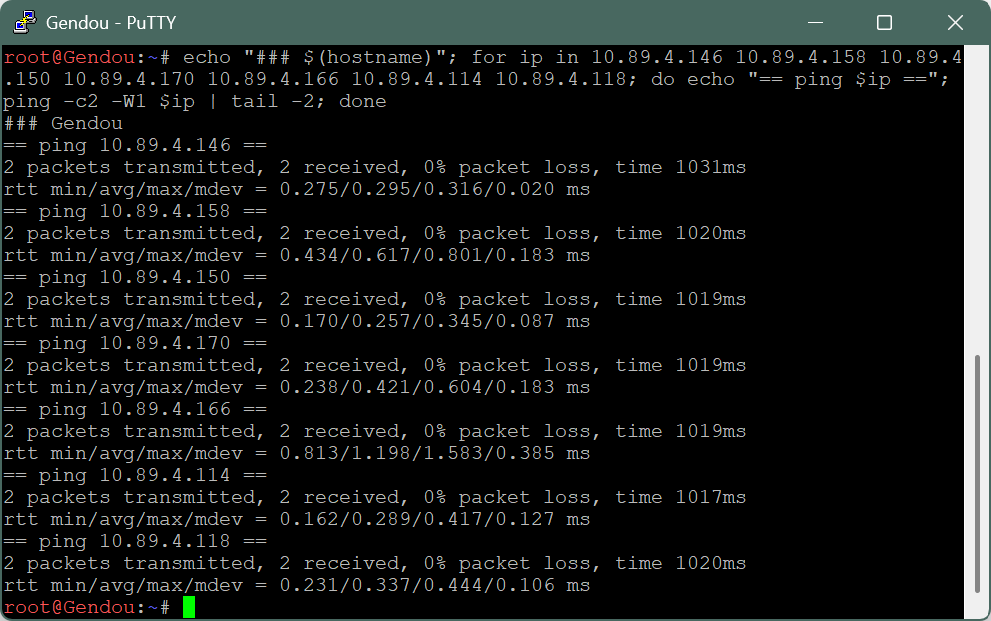 | Fuyutsuki  | Maya  |
| Toji  | Shigeru 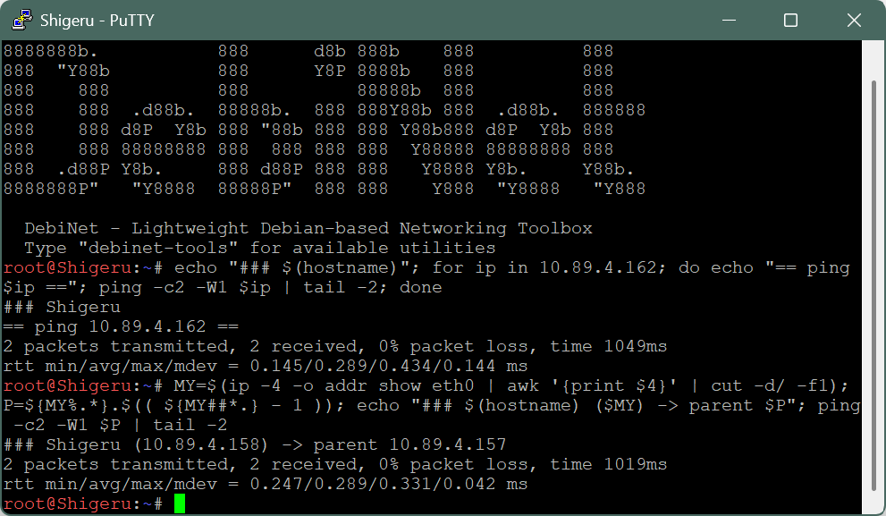 | Makoto  |
| Misato  | Kaji  | Asuka  |
| Kensuke  | Ritsuko 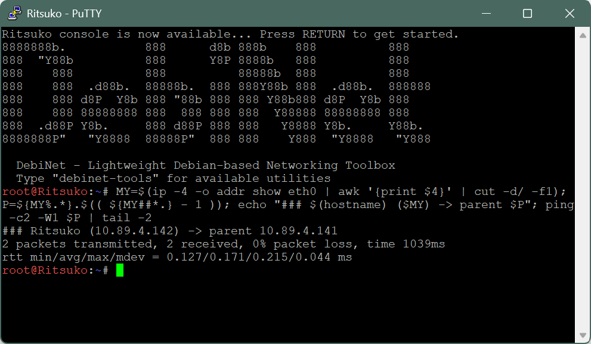 | Hikari 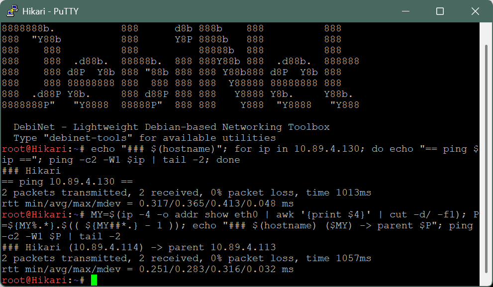 |
| Kaworu  | Yui  | Rei  |
| Shinji  | Mari  | |

---

## Soal 3 — Pulau-pulau yang terpisah (routing statis)

### Prinsip

Topologi berbentuk **pohon** dengan Gendou sebagai akar, sehingga:

- **Router selain Gendou** cukup punya `default route` ke router atasnya, ditambah rute ke subnet di bawahnya yang **tidak terhubung langsung** (LAN milik router anak).
- **Gendou** memakai default route ke NAT1 (didapat otomatis dari DHCP eth0), ditambah rute ke setiap subnet di tiap cabang yang tidak terhubung langsung.
- Subnet dalam satu cabang yang bisa digabung **tepat** menjadi satu CIDR wajib diringkas.

Analoginya seperti papan petunjuk jalan: di tiap persimpangan cukup ada papan "ke pusat kota → lurus" (default) dan papan khusus untuk kompleks di belakangnya.

### Analisis summarization

Subnet tiap cabang Gendou dicek apakah ada yang bisa digabung tepat menjadi satu CIDR (hasil `ipaddress.collapse_addresses`):

| Cabang | Subnet di cabang (selain link langsung ke Gendou) | Setelah diringkas |
|---|---|---|
| Fuyutsuki | 4.56/29, 3.192/27, 4.72/29, 4.124/30, 4.152/30 | tidak ada yang bisa digabung (5 rute) |
| **Shigeru** | **4.80/29 (Monolith) + 4.88/29 (Radar)**, 4.160/30 | **4.80/28**, 4.160/30 (2 rute) |
| Misato | 4.64/29 | 1 rute |
| Kaji | 4.100/30 | 1 rute |
| Asuka | 4.96/30, 3.128/26, 4.48/29, 4.120/30, 4.140/30 | tidak ada yang bisa digabung (5 rute) |
| Hikari | 2.0/24, 3.224/27, 4.128/30 | tidak ada yang bisa digabung (3 rute) |
| Yui | 0.0/23, 3.0/25, 4.0/27, 4.32/28, 4.108/30, 4.132/30, 4.136/30 | tidak ada yang bisa digabung (7 rute) |

Kenapa Monolith dan Radar bisa digabung: `10.89.4.80/29` (.80–.87) dan `10.89.4.88/29` (.88–.95) bersebelahan, sama besar, dan blok gabungannya `.80–.95` dimulai di kelipatan 16. Jadi tepat membentuk `10.89.4.80/28`, tanpa ada alamat cabang lain yang ikut. Pasangan lain tidak memenuhi syarat itu. Contohnya Garden `4.0/27` dan Dock `4.32/28`: kalau digabung jadi `4.0/26`, Lab `4.48/29` milik cabang Asuka ikut masuk.

### Tabel routing

| Router | Default route | Rute tambahan |
|---|---|---|
| Gendou | via NAT1 (DHCP) | 24 rute ke 7 cabang (lihat `gendo.sh`) |
| Fuyutsuki | 10.89.4.145 | 10.89.3.192/27 via .126 (Maya), 10.89.4.72/29 via .154 (Toji) |
| Shigeru | 10.89.4.157 | 10.89.4.88/29 via .162 (Makoto) |
| Asuka | 10.89.4.165 | 10.89.3.128/26 via .122 (Kensuke), 10.89.4.48/29 via .142 (Ritsuko) |
| Hikari | 10.89.4.113 | 10.89.3.224/27 via .130 (Kaworu) |
| Yui | 10.89.4.117 | 10.89.0.0/23 via .110 (Rei), 10.89.4.0/27 via .134 (Shinji), 10.89.4.32/28 via .138 (Mari) |
| Maya | 10.89.4.125 | – |
| Toji | 10.89.4.153 | – |
| Makoto | 10.89.4.161 | – |
| Misato | 10.89.4.149 | – |
| Kaji | 10.89.4.169 | – |
| Kensuke | 10.89.4.121 | – |
| Ritsuko | 10.89.4.141 | – |
| Kaworu | 10.89.4.129 | – |
| Rei | 10.89.4.109 | – |
| Shinji | 10.89.4.133 | – |
| Mari | 10.89.4.137 | – |

### Script

Rute ditulis di `/root/no3.sh` tiap router (khusus Gendou di `/root/gendo.sh`) (salinan lengkap ada di folder [`scripts/soal-3/`](scripts/soal-3/)). Script memakai `ip route replace`, bukan `add`, supaya bisa dijalankan berulang kali tanpa membuat rute dobel atau memunculkan error `File exists`.

`/root/gendo.sh`:

```bash
#!/bin/bash
echo 1 > /proc/sys/net/ipv4/ip_forward
# default route ke NAT1 sudah didapat otomatis dari DHCP eth0
# cabang Fuyutsuki (via 10.89.4.146)
ip route replace 10.89.4.56/29 via 10.89.4.146
ip route replace 10.89.3.192/27 via 10.89.4.146
ip route replace 10.89.4.72/29 via 10.89.4.146
ip route replace 10.89.4.124/30 via 10.89.4.146
ip route replace 10.89.4.152/30 via 10.89.4.146
# cabang Shigeru - Monolith + Radar diringkas jadi 10.89.4.80/28
ip route replace 10.89.4.80/28 via 10.89.4.158
ip route replace 10.89.4.160/30 via 10.89.4.158
# cabang Misato & Kaji
ip route replace 10.89.4.64/29 via 10.89.4.150
ip route replace 10.89.4.100/30 via 10.89.4.170
# cabang Asuka (via 10.89.4.166)
ip route replace 10.89.4.96/30 via 10.89.4.166
ip route replace 10.89.3.128/26 via 10.89.4.166
ip route replace 10.89.4.48/29 via 10.89.4.166
ip route replace 10.89.4.120/30 via 10.89.4.166
ip route replace 10.89.4.140/30 via 10.89.4.166
# cabang Hikari (via 10.89.4.114)
ip route replace 10.89.2.0/24 via 10.89.4.114
ip route replace 10.89.3.224/27 via 10.89.4.114
ip route replace 10.89.4.128/30 via 10.89.4.114
# cabang Yui (via 10.89.4.118)
ip route replace 10.89.3.0/25 via 10.89.4.118
ip route replace 10.89.0.0/23 via 10.89.4.118
ip route replace 10.89.4.0/27 via 10.89.4.118
ip route replace 10.89.4.32/28 via 10.89.4.118
ip route replace 10.89.4.108/30 via 10.89.4.118
ip route replace 10.89.4.132/30 via 10.89.4.118
ip route replace 10.89.4.136/30 via 10.89.4.118
```

Contoh router cabang, `/root/no3.sh` di Yui:

```bash
#!/bin/bash
echo 1 > /proc/sys/net/ipv4/ip_forward
ip route replace default via 10.89.4.117
ip route replace 10.89.0.0/23 via 10.89.4.110
ip route replace 10.89.4.0/27 via 10.89.4.134
ip route replace 10.89.4.32/28 via 10.89.4.138
```

### IP sementara node uji

Soal 3 meminta IP dan gateway **sementara** pada node uji (IP permanen dibuat di soal 6). Nilainya disamakan dengan tabel soal 1 supaya tidak bentrok nanti.

| Node | IP | Gateway |
|---|---|---|
| Armisael | 10.89.4.83/29 | 10.89.4.81 |
| Lilith | 10.89.4.74/29 | 10.89.4.73 |
| Sachiel | 10.89.3.130/26 | 10.89.3.129 |
| Comm-Net | 10.89.2.2/24 | 10.89.2.1 |

### Bukti

**Tabel routing Gendou.** Ada default route ke NAT1 (`192.168.122.1`) dari DHCP, rute tiap cabang mengarah ke interface yang benar (eth2 Fuyutsuki, eth3 Shigeru, eth4 Misato, eth5 Kaji, eth6 Asuka, eth7 Hikari, eth8 Yui), dan hasil summarization `10.89.4.80/28 via 10.89.4.158` muncul sebagai satu baris.


**Ping dari Armisael** ke Lilith (`10.89.4.74`), Sachiel (`10.89.3.130`), dan Comm-Net (`10.89.2.2`): semuanya 3/3 diterima, 0% packet loss.

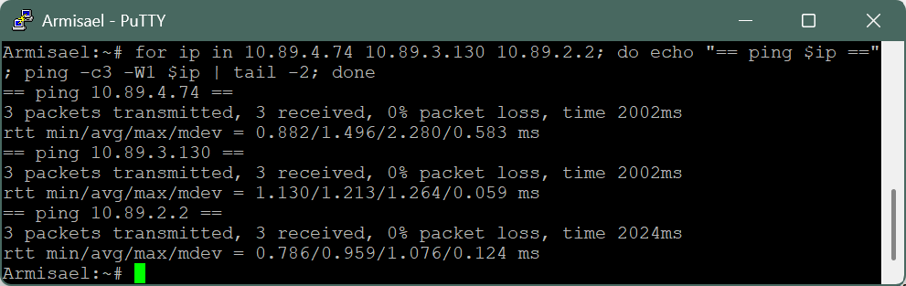

Jalur yang dilewati, contohnya Armisael → Comm-Net: Armisael → Shigeru (default) → Gendou (`10.89.2.0/24 via 10.89.4.114`) → Hikari (terhubung langsung) → Comm-Net. Balasannya lewat jalur kebalikan: Hikari (default) → Gendou (`10.89.4.80/28 via 10.89.4.158`) → Shigeru → Armisael.

---

## Soal 4 — Haus kabar dari dunia luar (NAT + DNS)

Mulai soal 4, script ditulis **per nomor soal**. Di node namanya `/root/no4.sh`, sedangkan salinannya di repo disimpan per router di [`scripts/soal-4/`](scripts/soal-4/).

### Konsep

Semua node internal memakai IP privat `10.89.x.x` yang tidak dikenal di internet. Gendou menerjemahkan alamat sumbernya menjadi IP eth0 miliknya (alamat dari NAT1) saat paket keluar. Analoginya: semua warga mengirim surat ke luar kota lewat satu kantor pos, dan alamat pengirimnya diganti jadi alamat kantor pos itu. Balasan datang ke kantor pos, lalu diteruskan ke warga yang benar berkat tabel conntrack.

Tiga syarat soal dipenuhi lewat satu rule:

| Syarat soal | Cara memenuhi |
|---|---|
| Tidak perlu diubah saat IP NAT1 berganti | Pakai **`MASQUERADE`**, bukan `SNAT --to-source`. MASQUERADE selalu memakai IP eth0 yang sedang aktif. |
| Hanya traffic dari prefix internal yang diterjemahkan | Pakai `-s 10.89.0.0/21` (seluruh alokasi soal 1). |
| Traffic antar-LAN tetap membawa alamat asli | Pakai `-o eth0`. Rule hanya berlaku untuk paket yang keluar ke NAT1, sedangkan paket antar-LAN keluar lewat eth1–eth8 sehingga tidak tersentuh. |

Untuk DNS, semua router dan node uji diberi `nameserver 192.168.122.1` (DNS dari NAT1) dan `8.8.8.8` sebagai cadangan di `/etc/resolv.conf`, supaya bisa me-resolve nama domain sebelum memasang paket.

### Script

`/root/no4.sh` di **Gendou** ([`scripts/soal-4/gendou.sh`](scripts/soal-4/gendou.sh)):

```bash
#!/bin/bash
cat > /etc/resolv.conf << 'R'
nameserver 192.168.122.1
nameserver 8.8.8.8
R

command -v iptables >/dev/null || { apt-get update && apt-get install -y iptables; }

iptables -t nat -C POSTROUTING -s 10.89.0.0/21 -o eth0 -j MASQUERADE 2>/dev/null \
  || iptables -t nat -A POSTROUTING -s 10.89.0.0/21 -o eth0 -j MASQUERADE

iptables -t nat -L POSTROUTING -n -v --line-numbers
```

`iptables -C ... || iptables -A ...` mengecek dulu apakah rule sudah ada, jadi script bisa dijalankan berulang tanpa membuat rule dobel.

`/root/no4.sh` di **16 router lain** (isinya sama). Router memasang DNS, lalu memasang iptables kalau belum ada. Langkah ini baru bisa dilakukan setelah NAT di Gendou aktif:

```bash
#!/bin/bash
cat > /etc/resolv.conf << 'R'
nameserver 192.168.122.1
nameserver 8.8.8.8
R
command -v iptables >/dev/null || { apt-get update && apt-get install -y iptables; }
cat /etc/resolv.conf
```

Untuk node uji (Armisael, Lilith, Sachiel, Comm-Net), IP, gateway, dan DNS dipasang permanen lewat **Edit network configuration**. Nilainya sama dengan tabel soal 1, sehingga sekaligus memenuhi soal 6 untuk keempat node ini. Contoh Armisael:

```
auto eth0
iface eth0 inet static
    address 10.89.4.83
    netmask 255.255.255.248
    gateway 10.89.4.81
    up echo -e "nameserver 192.168.122.1\nnameserver 8.8.8.8" > /etc/resolv.conf
```

### Bukti

**Armisael**: ping `8.8.8.8` berhasil, `deb.debian.org` ter-resolve (ke `debian.map.fastlydns.net`) dan berhasil di-ping. Semuanya 0% packet loss.


**Lilith**: ping `8.8.8.8` dan `deb.debian.org` berhasil, 0% packet loss.

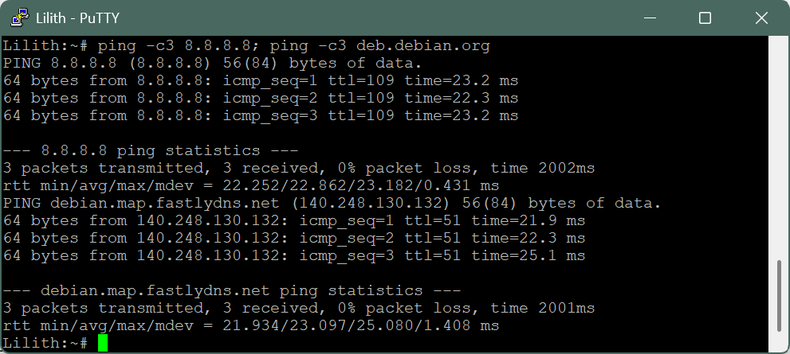

**Counter rule NAT di Gendou**: rule `MASQUERADE` dengan `out eth0` dan `source 10.89.0.0/21` mencatat **12 paket / 872 byte**. Jadi traffic dari dalam benar-benar diterjemahkan oleh rule ini.

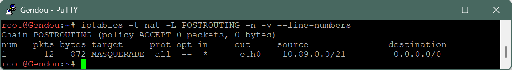

> Counternya kecil walaupun ping-nya banyak karena rule di tabel `nat` hanya dievaluasi untuk **paket pertama tiap koneksi**. Paket berikutnya, termasuk balasannya, diterjemahkan otomatis oleh *connection tracking* tanpa melewati rule lagi. Satu rangkaian ping dihitung satu "koneksi" ICMP, dan satu query DNS dihitung satu koneksi UDP.

**Contoh router lain (Toji)**: `no4.sh` memasang DNS. iptables sudah tersedia di image, jadi tidak perlu di-install.


---

## Soal 5 — Pintu depan dikunci rapat (firewall Gendou)

### Konsep

Policy **INPUT** dan **FORWARD** di Gendou diubah menjadi **DROP**, sehingga semua paket yang tidak ada di daftar izin ditolak. Analoginya seperti satpam dengan daftar tamu: yang namanya tidak tercantum tidak boleh masuk.

| Izin yang diminta soal | Chain | Rule |
|---|---|---|
| Loopback | INPUT | `-i lo` |
| (a) Balasan koneksi yang sudah ada | INPUT & FORWARD | `-m conntrack --ctstate ESTABLISHED,RELATED` |
| DHCP dari NAT1 | INPUT | `-i eth0 -p udp --sport 67 --dport 68` |
| (d) Jaringan internal → Gendou sendiri | INPUT | `! -i eth0 -s 10.89.0.0/21` |
| (b) Jaringan internal → internet | FORWARD | `! -i eth0 -s 10.89.0.0/21 -o eth0` |
| (c) Antar-LAN | FORWARD | `! -i eth0 ! -o eth0 -s 10.89.0.0/21 -d 10.89.0.0/21` |

Kenapa "boleh keluar, tidak boleh dimasuki" bisa tercapai: paket dari dalam ke internet lolos lewat rule (b), dan balasannya berstatus **ESTABLISHED** sehingga lolos lewat rule (a). Koneksi yang **dimulai** dari sisi NAT1 berstatus **NEW**, tidak cocok dengan rule mana pun, sehingga dibuang oleh policy DROP.

Kondisi `! -i eth0` dipakai supaya paket dari arah NAT1 tidak bisa menyamar memakai alamat sumber `10.89.x.x` (anti-spoofing).

Di script, semua rule izin dipasang lebih dulu, baru policy diubah ke DROP **paling akhir**. Dengan begitu tidak ada jeda waktu ketika Gendou terkunci total. Script juga mengosongkan chain INPUT dan FORWARD sebelum memasang ulang, sehingga aman dijalankan berulang tanpa membuat rule dobel.

### Script `/root/gendo.sh`

Sesuai permintaan soal, seluruh konfigurasi Gendou untuk soal 2–5 ditulis dalam satu file `gendo.sh`:

```bash
#!/bin/bash
# /root/gendo.sh — Gendou: Soal 2, 3, 4, 5
INTERNAL=10.89.0.0/21
WAN=eth0

# ===== Soal 2: IP forwarding =====
echo 1 > /proc/sys/net/ipv4/ip_forward

# ===== Soal 3: routing statis (default ke NAT1 dari DHCP eth0) =====
ip route replace 10.89.4.56/29 via 10.89.4.146
ip route replace 10.89.3.192/27 via 10.89.4.146
ip route replace 10.89.4.72/29 via 10.89.4.146
ip route replace 10.89.4.124/30 via 10.89.4.146
ip route replace 10.89.4.152/30 via 10.89.4.146
ip route replace 10.89.4.80/28 via 10.89.4.158
ip route replace 10.89.4.160/30 via 10.89.4.158
ip route replace 10.89.4.64/29 via 10.89.4.150
ip route replace 10.89.4.100/30 via 10.89.4.170
ip route replace 10.89.4.96/30 via 10.89.4.166
ip route replace 10.89.3.128/26 via 10.89.4.166
ip route replace 10.89.4.48/29 via 10.89.4.166
ip route replace 10.89.4.120/30 via 10.89.4.166
ip route replace 10.89.4.140/30 via 10.89.4.166
ip route replace 10.89.2.0/24 via 10.89.4.114
ip route replace 10.89.3.224/27 via 10.89.4.114
ip route replace 10.89.4.128/30 via 10.89.4.114
ip route replace 10.89.3.0/25 via 10.89.4.118
ip route replace 10.89.0.0/23 via 10.89.4.118
ip route replace 10.89.4.0/27 via 10.89.4.118
ip route replace 10.89.4.32/28 via 10.89.4.118
ip route replace 10.89.4.108/30 via 10.89.4.118
ip route replace 10.89.4.132/30 via 10.89.4.118
ip route replace 10.89.4.136/30 via 10.89.4.118

# ===== Soal 4: DNS + NAT =====
printf 'nameserver 192.168.122.1\nnameserver 8.8.8.8\n' > /etc/resolv.conf
iptables -t nat -C POSTROUTING -s $INTERNAL -o $WAN -j MASQUERADE 2>/dev/null \
  || iptables -t nat -A POSTROUTING -s $INTERNAL -o $WAN -j MASQUERADE

# ===== Soal 5: firewall =====
iptables -P INPUT ACCEPT
iptables -P FORWARD ACCEPT
iptables -F INPUT
iptables -F FORWARD

iptables -A INPUT -i lo -j ACCEPT
iptables -A INPUT -m conntrack --ctstate ESTABLISHED,RELATED -j ACCEPT          # (a)
iptables -A INPUT -i $WAN -p udp --sport 67 --dport 68 -j ACCEPT                # DHCP
iptables -A INPUT ! -i $WAN -s $INTERNAL -j ACCEPT                              # (d)

iptables -A FORWARD -m conntrack --ctstate ESTABLISHED,RELATED -j ACCEPT        # (a)
iptables -A FORWARD ! -i $WAN -s $INTERNAL -o $WAN -j ACCEPT                    # (b)
iptables -A FORWARD ! -i $WAN ! -o $WAN -s $INTERNAL -d $INTERNAL -j ACCEPT     # (c)

iptables -P INPUT DROP
iptables -P FORWARD DROP

iptables -S
```

### Bukti

**`iptables -S` di Gendou**: policy INPUT dan FORWARD sudah DROP, OUTPUT tetap ACCEPT, dan 7 rule izin terpasang sesuai tabel.


**Armisael tetap bisa ping `8.8.8.8`**: 3/3 diterima, 0% packet loss.


**Soal 2–4 tetap jalan**:
- eth0 Gendou masih memegang IP DHCP `192.168.122.16/24`.
- Gendou sendiri masih bisa ping `8.8.8.8`. Balasannya masuk lewat rule ESTABLISHED di INPUT (counter 4 paket).
- Counter FORWARD: rule (a) ESTABLISHED 23 paket, rule (b) internal → internet 8 paket, rule (c) antar-LAN 2 paket. Artinya traffic internet dan antar-LAN sama-sama lewat rule izin masing-masing.
- Counter policy DROP masih 0: belum ada paket sah yang ikut terbuang.


---

## Soal 6 — Konfigurasi IP Permanen pada Seluruh Host

### Alur Pengerjaan
1. Agar seluruh 25 host node (`alpinet` maupun `debinet`) tidak kehilangan alamat IP statis maupun rute *default gateway* setelah container di-restart, konfigurasi interface dipindahkan dari perintah manual (`ip addr` / `ip route`) ke file `/etc/network/interfaces` (lewat **Edit network configuration** di GNS3).
2. Struktur konfigurasi pada tiap host memakai `auto eth0` dan `iface eth0 inet static` sesuai IP host, netmask, dan gateway masing-masing subnet di tabel soal 1 (`10.89.0.0/21`).
3. Setelah disimpan dan node dinyalakan ulang, konfigurasi dicek dengan `ip -br a`, `ip route`, dan `ping` ke gateway masing-masing.

### Contoh Konfigurasi (`/etc/network/interfaces` di `Unit-01`)
```text
auto lo
iface lo inet loopback

auto eth0
iface eth0 inet static
    address 10.89.4.66
    netmask 255.255.255.248
    gateway 10.89.4.65
```

### Bukti

**Verifikasi `ip -br a`, `ip route`, dan ping ke gateway (`10.89.4.65`) di `Unit-01`:**

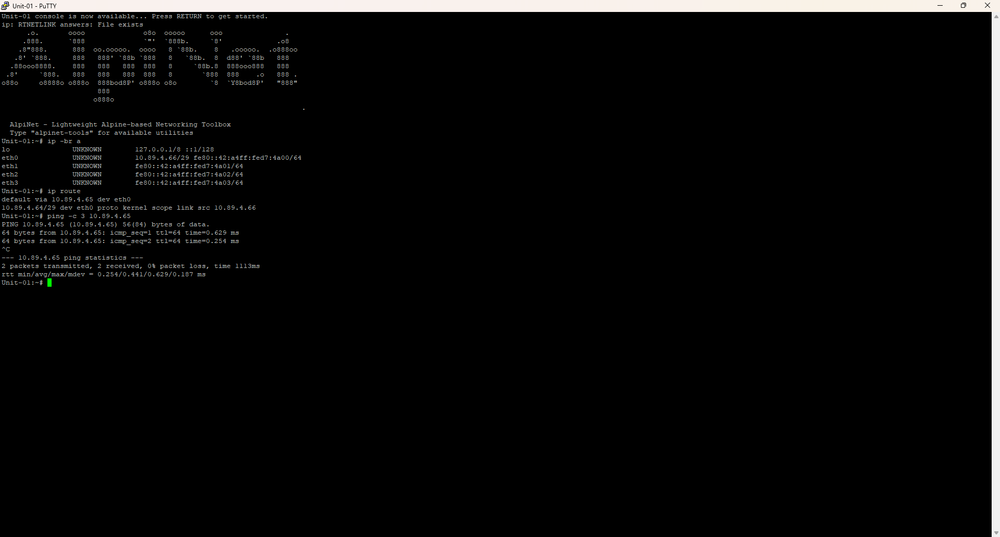

---

## Soal 7 — Mengenali Kondisi Normal: Layanan Internal MAGI

### Alur Pengerjaan
1. Membuat dan menjalankan script `/root/magi.sh` di ketiga node MAGI menggunakan listener `netcat-traditional` yang berjalan terus di background dan mencatat pesan yang masuk ke file log:
   - **Magi-Casper (`10.89.4.58`)** listen di port **TCP 5000** → `/root/casper_5000.log`
   - **Magi-Balthasar (`10.89.4.59`)** listen di port **TCP 5000** dan **TCP 5001** → `/root/balthasar_5000.log` & `/root/balthasar_5001.log`
   - **Magi-Melchior (`10.89.4.60`)** listen di port **TCP 5000** → `/root/melchior_5000.log`
2. Menguji pengiriman pesan dari **Lilith (`10.89.4.74`)** ke keempat port layanan MAGI lalu mengecek isi file log di masing-masing node MAGI.

### Script `/root/magi.sh`

**Magi-Casper (`10.89.4.58`):**
```bash
#!/bin/bash
apt-get update && apt-get install -y iptables netcat-traditional
pkill -f "nc -l" 2>/dev/null
while true; do
    nc -l -p 5000 >> /root/casper_5000.log 2>&1
done &
```

**Magi-Balthasar (`10.89.4.59`):**
```bash
#!/bin/bash
apt-get update && apt-get install -y iptables netcat-traditional
pkill -f "nc " 2>/dev/null
touch /root/balthasar_5000.log /root/balthasar_5001.log
nohup sh -c 'while true; do nc.traditional -l -p 5000 >> /root/balthasar_5000.log 2>&1 || nc -l 5000 >> /root/balthasar_5000.log 2>&1; done' >/dev/null 2>&1 &
nohup sh -c 'while true; do nc.traditional -l -p 5001 >> /root/balthasar_5001.log 2>&1 || nc -l 5001 >> /root/balthasar_5001.log 2>&1; done' >/dev/null 2>&1 &
```

**Magi-Melchior (`10.89.4.60`):**
```bash
#!/bin/bash
apt-get update && apt-get install -y iptables netcat-traditional
pkill -f "nc " 2>/dev/null
touch /root/melchior_5000.log
nohup sh -c 'while true; do nc.traditional -l -p 5000 >> /root/melchior_5000.log 2>&1 || nc -l 5000 >> /root/melchior_5000.log 2>&1; done' >/dev/null 2>&1 &
```

### Bukti

**Magi-Casper (`/root/casper_5000.log`):**

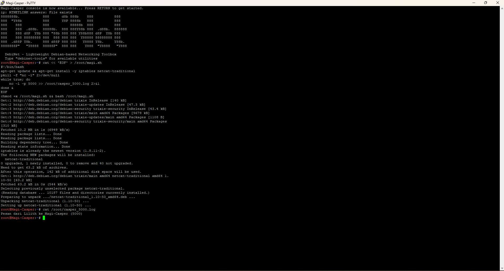

**Magi-Balthasar (`/root/balthasar_5000.log` dan `/root/balthasar_5001.log`):**

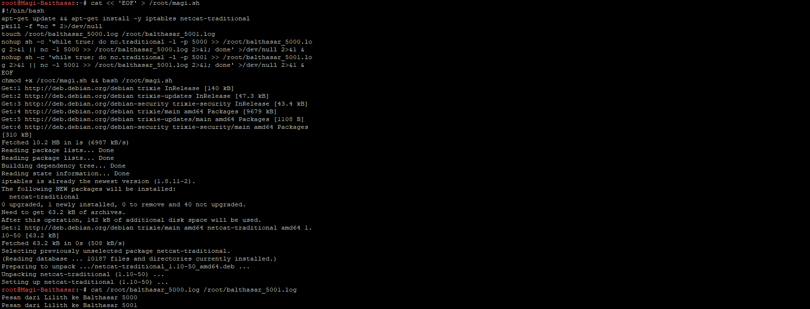

**Magi-Melchior (`/root/melchior_5000.log`):**

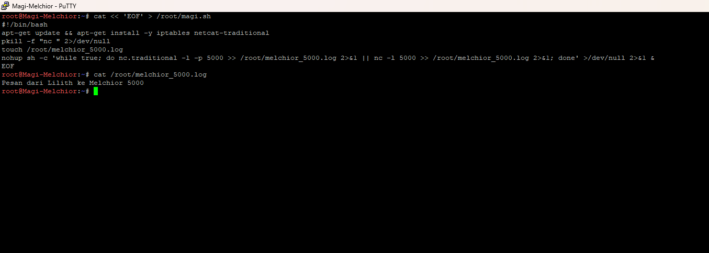

---

## Soal 8 — Mengenali Kondisi Normal: Layanan HTTP (`Pen-Pen` & `Tokyo3-Core`)

### Alur Pengerjaan
1. Membuat script `/root/service.sh` di **Pen-Pen (`10.89.3.195`)** untuk membuka listener di port **TCP 80** yang membalas setiap koneksi dengan `Welcome to Pen-Pen`.
2. Membuat script `/root/service.sh` di **Tokyo3-Core (`10.89.4.106`)** untuk membuka listener di port **TCP 80** (`Welcome to Tokyo3-Core`) dan port **TCP 8080** (`syifa imutz`).
3. Menguji koneksi dari **Lilith (`10.89.4.74`)** memakai `nc -v -w 2` ke ketiga port tersebut, serta menguji akses ke port tertutup (**TCP 22**) untuk memastikan koneksi langsung ditolak (`Connection refused`, `Exit code: 1`) dan tidak menggantung sampai timeout.

### Script `/root/service.sh`

**Pen-Pen (`10.89.3.195`):**
```bash
#!/bin/bash
if command -v apt-get >/dev/null 2>&1; then
    apt-get update && apt-get install -y iptables netcat-traditional
else
    apk add --no-cache iptables netcat-openbsd
fi
pkill -f "nc.*80" 2>/dev/null
nohup sh -c 'while true; do echo "Welcome to $(hostname)" | nc.traditional -l -p 80 -q 1 2>/dev/null || echo "Welcome to $(hostname)" | nc -l 80 -w 1 2>/dev/null; done' >/dev/null 2>&1 &
```

**Tokyo3-Core (`10.89.4.106`):**
```bash
#!/bin/bash
if command -v apt-get >/dev/null 2>&1; then
    apt-get update && apt-get install -y iptables netcat-traditional
else
    apk add --no-cache iptables netcat-openbsd
fi
pkill -f "nc.*80" 2>/dev/null
nohup sh -c 'while true; do echo "Welcome to $(hostname)" | nc.traditional -l -p 80 -q 1 2>/dev/null || echo "Welcome to $(hostname)" | nc -l 80 -w 1 2>/dev/null; done' >/dev/null 2>&1 &
nohup sh -c 'while true; do echo "syifa imutz" | nc.traditional -l -p 8080 -q 1 2>/dev/null || echo "syifa imutz" | nc -l 8080 -w 1 2>/dev/null; done' >/dev/null 2>&1 &
```

### Bukti

**Uji `nc` dari Lilith ke Pen-Pen (`80`), Tokyo3-Core (`80` dan `8080`), serta port tertutup (`22`):**

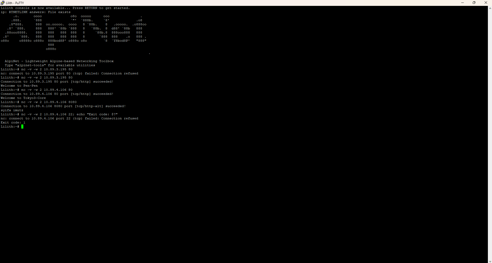

---

## Soal 9 — Sabotase 1: Jalur Belakang Diutak-atik (`break_routing.sh` di Shigeru)

### Alur Pengerjaan
1. Menjalankan `/root/break_routing.sh` di router **Shigeru** tanpa membaca isinya.
2. Mengecek gejala awal: `ping` dari **Armisael (`10.89.4.83`)** ke gateway **Shigeru (`10.89.4.81`)** tetap berhasil (`0% packet loss`), tetapi `ping` dari **Lilith (`10.89.4.74`)** ke **Armisael (`10.89.4.83`)** gagal (`100% packet loss`).
3. Memeriksa konfigurasi routing di Shigeru dengan `sysctl net.ipv4.ip_forward`, `ip route show`, dan `ip rule show`.
4. Memperbaiki keempat masalah routing di Shigeru lalu menguji kembali `ping` dari **Lilith** ke **Armisael** sampai berhasil.

### Penyebab Kerusakan
Dari pengecekan di **Shigeru**, ada 4 hal yang diubah oleh `break_routing.sh`:
1. **IP forwarding mati (`net.ipv4.ip_forward = 0`):** Shigeru tidak meneruskan paket antar-interface.
2. **Default route dibelokkan ke Makoto:** Rute `default` yang seharusnya ke **Gendou (`10.89.4.157` via `eth0`)** malah diarahkan ke router anak **Makoto (`10.89.4.162` via `eth2`)**.
3. **Ada rute `blackhole` ke subnet Dogma (`10.89.4.72/29`):** Paket dari Shigeru yang menuju subnet Lilith/Adam langsung dibuang oleh kernel.
4. **Policy routing (`ip rule` + `table 100`):** Ada rule `iif eth1 lookup 100` (priority 90) yang melempar paket masuk dari Switch-Monolith (`eth1`) ke `table 100` berisi `unreachable default` sebelum sempat mengecek tabel routing `main`.

**Kenapa Armisael masih bisa ping gateway (`10.89.4.81`), tapi Lilith gagal ping Armisael?**  
Karena Armisael (`10.89.4.83`) dan `eth1` Shigeru (`10.89.4.81`) berada di satu subnet yang sama (`10.89.4.80/29`) dan paketnya ditujukan langsung ke IP milik Shigeru sendiri (proses `INPUT` lokal), sehingga tidak butuh `ip_forward` maupun forwarding antar-interface. Sebaliknya, paket dari Lilith ke Armisael harus melewati proses forwarding dan pembacaan tabel routing di Shigeru yang keempat komponennya sedang rusak.

### Perbaikan di Shigeru
```bash
sysctl -w net.ipv4.ip_forward=1
ip rule del iif eth1 lookup 100 priority 90 2>/dev/null
ip route flush table 100 2>/dev/null
ip route del blackhole 10.89.4.72/29 2>/dev/null
ip route replace default via 10.89.4.157 dev eth0
```

### Bukti

**Sebelum diperbaiki — Armisael tetap bisa ping gateway Shigeru (`10.89.4.81`):**

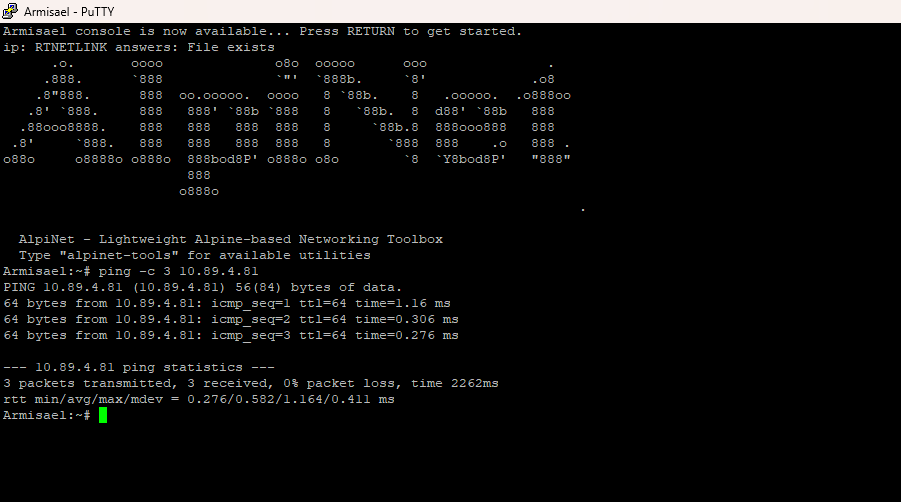

**Sebelum diperbaiki — Lilith gagal ping ke Armisael (`10.89.4.83`):**

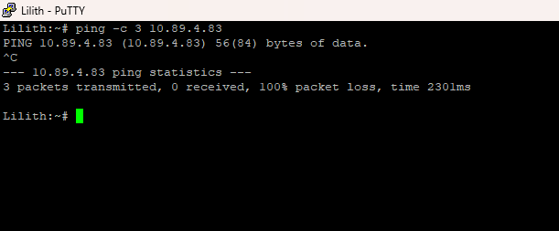

**Perbaikan di Shigeru:**

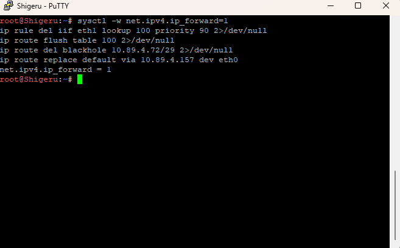

**Setelah diperbaiki — Lilith berhasil ping ke Armisael (`0% packet loss`):**

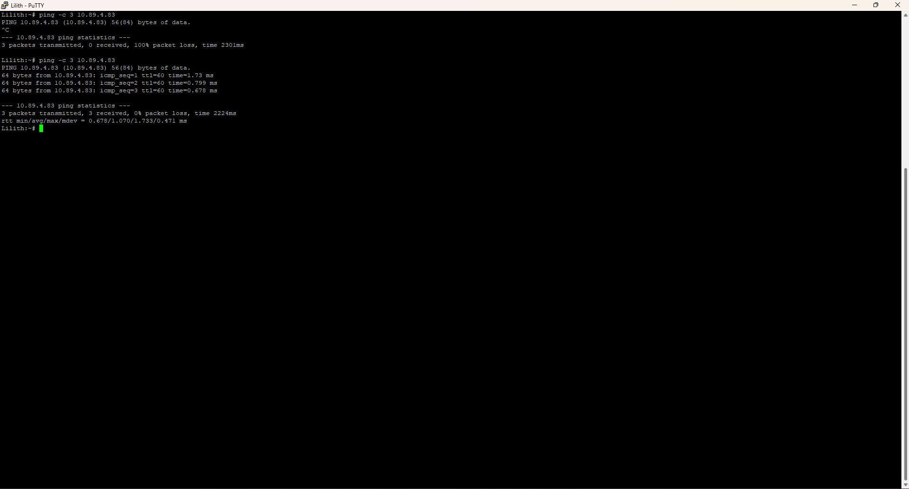

---

## Soal 10 — Sabotase 2: Para Pilot Terkunci di Dalam (`break_nat.sh` di Misato & Gendou)

### Alur Pengerjaan
1. Menjalankan `/root/break_nat.sh` di router **Misato** dan router **Gendou**.
2. Mengecek gejala dari node klien:
   - Dari **Unit-01 (`10.89.4.66` — Switch-Cage)**: `ping 8.8.8.8` gagal (`100% packet loss`), tetapi `ping 10.89.4.74` (**Lilith**) tetap berhasil (`0% packet loss`).
   - Dari **Spy (`10.89.4.102` — Switch-Intel)**: `ping 8.8.8.8` tetap berhasil normal.
3. Mengecek isi tabel NAT (`iptables -t nat -S`) di **Misato** dan **Gendou**, menghapus kedua rule pengganggu, lalu menguji ulang `ping 8.8.8.8` dari **Unit-01**.

### Penyebab Kerusakan
`break_nat.sh` memasang dua rule NAT yang mengganggu subnet Switch-Cage (`10.89.4.64/29`):
1. **Di Misato:** Ada rule `POSTROUTING -s 10.89.4.64/29 ! -d 10.89.0.0/16 -o eth0 -j SNAT --to-source 172.31.99.1`. Paket dari Switch-Cage yang tujuannya ke luar jaringan internal (`! -d 10.89.0.0/16`) diubah alamat sumbernya menjadi `172.31.99.1`, sehingga tidak dikenali oleh Gendou (yang hanya men-NAT dan mengizinkan `10.89.0.0/21`).
2. **Di Gendou:** Ada rule `POSTROUTING -s 10.89.4.64/29 -o eth0 -j RETURN` di urutan paling atas chain `POSTROUTING`. Rule `RETURN` ini membuat paket dari Switch-Cage keluar dari chain `POSTROUTING` sebelum sempat mengenai rule `MASQUERADE`, sehingga keluar ke `NAT1` masih membawa IP privat `10.89.4.66`.

**Jawaban pertanyaan soal:**
- **Kenapa Switch-Cage gagal ke `8.8.8.8` tapi berhasil ke Lilith, sedangkan Switch-Intel (`Spy`) aman?**  
  Saat Unit-01 mem-ping **Lilith (`10.89.4.74`)**, alamat tujuannya masih di dalam `10.89.0.0/16` dan paketnya tidak keluar lewat `eth0` Gendou, sehingga tidak cocok dengan rule SNAT di Misato (`! -d 10.89.0.0/16`) maupun rule `RETURN` di Gendou (`-o eth0`). Sedangkan **Spy (`10.89.4.102`)** berada di bawah router **Kaji** (`10.89.4.100/30`), sehingga tidak melewati Misato dan tidak cocok dengan filter `-s 10.89.4.64/29` di Gendou.
- **Di router mana alamat sumber diterjemahkan?**  
  Translasi NAT (`MASQUERADE`) ke internet hanya dilakukan di router **Gendou** pada interface `eth0` yang menghadap `NAT1`. Router cabang seperti Misato cukup meneruskan paket (routing biasa) tanpa melakukan NAT.

### Perbaikan di Misato & Gendou
```bash
# Di Misato: hapus SNAT ke 172.31.99.1
iptables -t nat -D POSTROUTING -s 10.89.4.64/29 ! -d 10.89.0.0/16 -o eth0 -j SNAT --to-source 172.31.99.1

# Di Gendou: hapus rule RETURN yang melewati MASQUERADE
iptables -t nat -D POSTROUTING -s 10.89.4.64/29 -o eth0 -j RETURN
```

### Bukti

**Sebelum diperbaiki — dari `Unit-01`, ping `8.8.8.8` gagal tetapi ping `10.89.4.74` (Lilith) berhasil:**

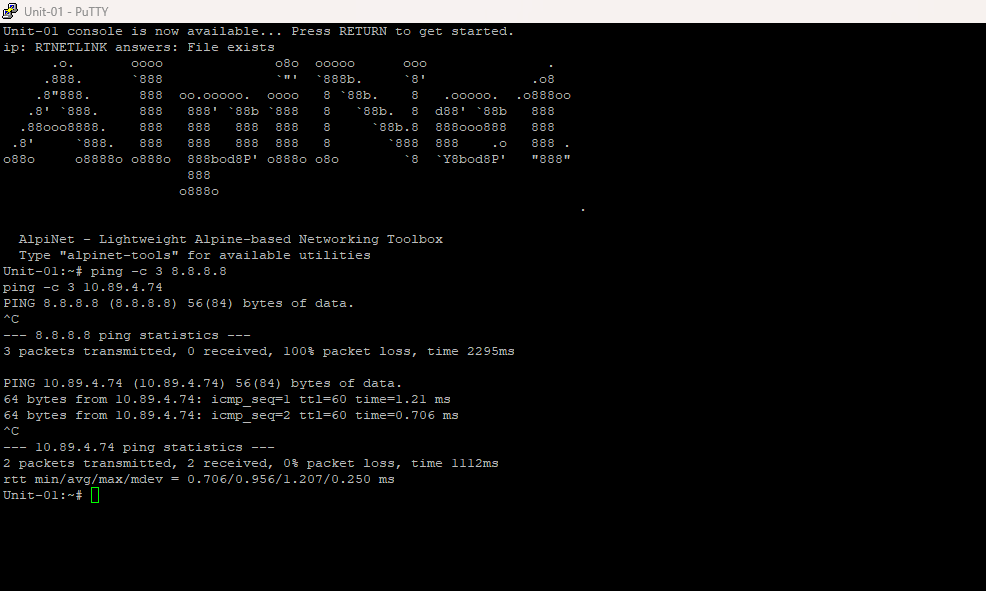

**Sebelum diperbaiki — dari `Spy` (Switch-Intel), ping `8.8.8.8` tetap berhasil:**

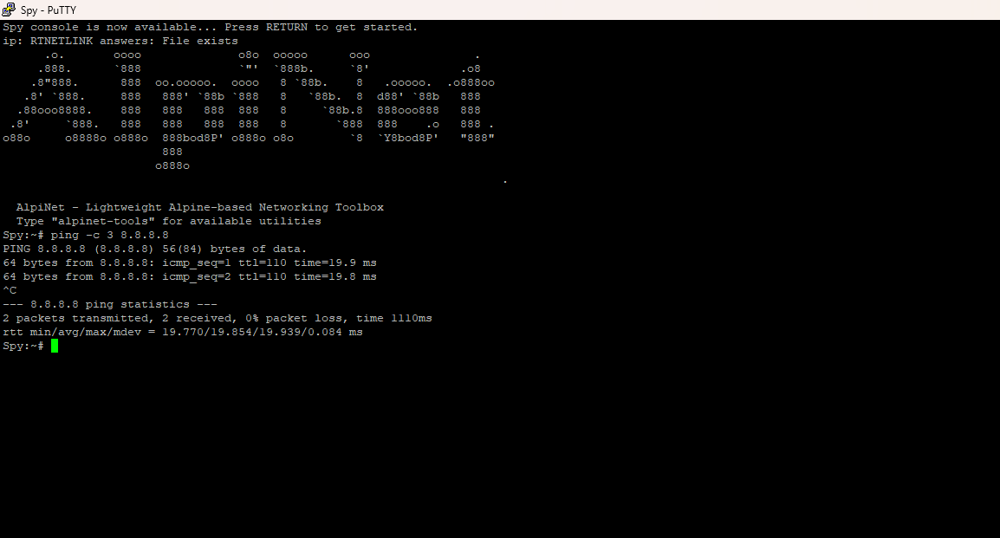

**Setelah diperbaiki — dari `Unit-01`, ping `8.8.8.8` kembali berhasil (`0% packet loss`):**

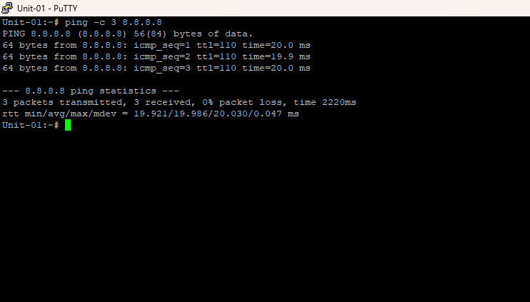

---

## Soal 11 — Casper harus jadi hantu (`Magi-Casper`)

### Konsep

Yang diblok hanya **ICMP echo-request yang masuk ke Casper**. Rule dipasang di **Casper sendiri** (chain `INPUT`), bukan di router.

| Keputusan | Alasan |
|---|---|
| Rule dipasang di **Casper**, bukan di Fuyutsuki | Balthasar dan Melchior satu switch dengan Casper, sehingga ping mereka **tidak melewati router**. Satu-satunya titik yang pasti dilewati semua ping ke Casper adalah Casper sendiri. |
| Yang diblok hanya **echo-request** (ICMP type 8) | Saat Casper mem-ping node lain, balasannya datang sebagai **echo-reply** (type 0). Kalau semua ICMP diblok, ping keluar dari Casper ikut gagal. |
| Target **DROP**, bukan REJECT | REJECT mengirim balasan penolakan, sehingga pengirim tahu Casper masih hidup. DROP membuang paket tanpa jejak, jadi Casper terlihat seperti tidak ada ("hantu"). |
| TCP 5000 tidak disentuh | Rule hanya menyaring `-p icmp`, jadi lalu lintas TCP tetap lewat. |

### Script `/root/no11.sh` (Magi-Casper)

```bash
#!/bin/bash
iptables -C INPUT -p icmp --icmp-type echo-request -j DROP 2>/dev/null \
  || iptables -I INPUT 1 -p icmp --icmp-type echo-request -j DROP

iptables -L INPUT -n -v --line-numbers
```

`-I INPUT 1` menaruh rule di urutan paling atas, sehingga tidak bisa didahului rule `ACCEPT` lain. Pola `-C ... ||` mencegah rule dobel kalau script dijalankan ulang.

### Bukti

**Ping dari Magi-Balthasar ke Casper gagal**: 3 paket dikirim, 0 diterima, 100% packet loss. Ini membuktikan tetangga satu switch pun tidak bisa mem-ping Casper.

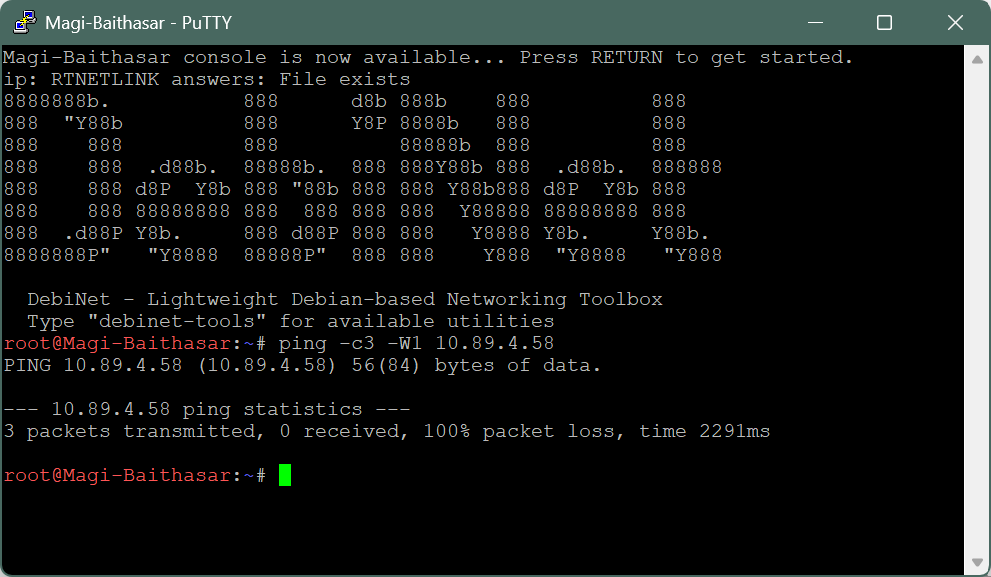

**Ping dari Lilith ke Casper gagal**: 100% packet loss.

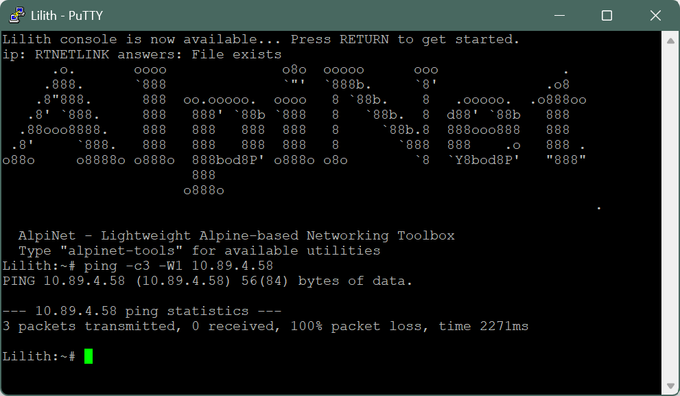

**Ping dari Casper ke Balthasar (`10.89.4.59`) dan Lilith (`10.89.4.74`) berhasil**: keduanya 0% packet loss. Balasan echo-reply tetap bisa masuk.

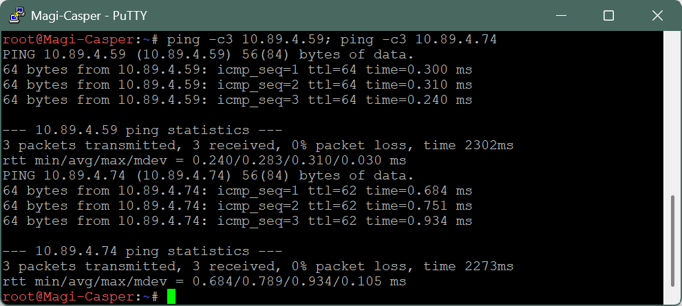

**Counter rule dan layanan TCP 5000**: rule `DROP icmp icmptype 8` mencatat **6 paket**, yaitu 3 ping dari Balthasar dan 3 dari Lilith. Rule ini hanya menyaring ICMP, jadi TCP 5000 tidak tersentuh.

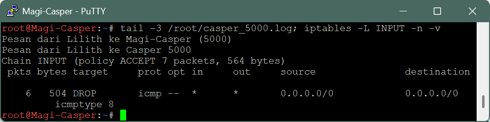

Percobaan pertama nc dari Lilith ke port 5000 menghasilkan `exit=1`. Penyebabnya ternyata listener `nc` di Casper sudah mati setelah node di-restart, bukan karena rule soal 11 (lihat penyebab no. 5 di soal 12).

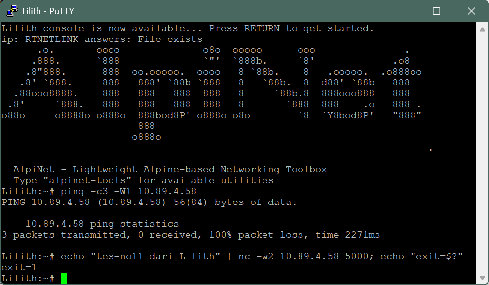

Setelah listener dinyalakan ulang, nc dari Lilith ke port 5000 berhasil (`exit=0`), dan pesan `tes-no11 dari Lilith` tercatat di `/root/casper_5000.log` (lihat screenshot Casper di soal 12). Jadi layanan TCP 5000 tetap hidup walaupun ping ke Casper diblok.

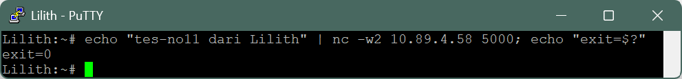

---

## Soal 12 — Teknisi yang kelewat semangat (`break_fw.sh` di `Magi-Casper`)

### Kondisi setelah `break_fw.sh` dijalankan

Script dijalankan tanpa dibaca isinya. Diagnosa dilakukan dari gejala dan kondisi sistem (`iptables -S`, counter rule, uji ping, apt-get, nc).

```
-P INPUT DROP
-P FORWARD ACCEPT
-P OUTPUT ACCEPT
-A INPUT -i lo -j ACCEPT
-A INPUT -p icmp -j DROP
-A OUTPUT -p udp -m udp --dport 53 -j DROP
```

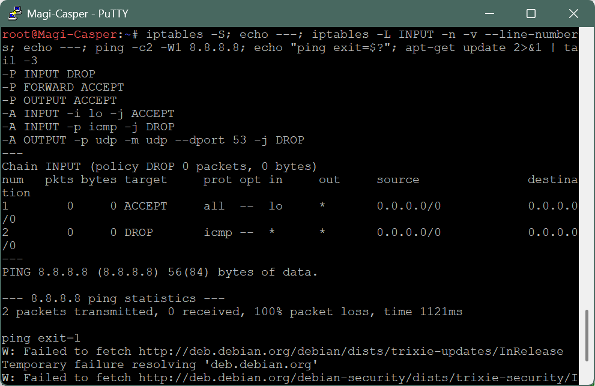

### Penyebab

Ditemukan **empat penyebab firewall** ditambah **satu masalah layanan**:

| # | Penyebab | Gejala |
|---|---|---|
| 1 | Policy INPUT `DROP` tanpa rule `ESTABLISHED,RELATED` | Semua **balasan** dari luar dibuang. Casper bisa mengirim permintaan, tapi jawabannya tidak pernah boleh masuk. |
| 2 | `-A INPUT -p icmp -j DROP` terlalu luas (semua tipe ICMP) | Echo-reply dari 8.8.8.8 ikut dibuang → **ping 8.8.8.8 gagal**. |
| 3 | `-A OUTPUT -p udp --dport 53 -j DROP` | Query DNS tidak bisa keluar → `Temporary failure resolving 'deb.debian.org'` → **apt-get update gagal**. |
| 4 | Tidak ada rule `ACCEPT` untuk TCP 5000 | SYN dari Unit-00 dibuang policy DROP → **nc ke port 5000 gagal**. |
| 5 | Listener `nc` port 5000 sudah tidak berjalan (bukan akibat `break_fw.sh`) | Setelah firewall diperbaiki, SYN dari Unit-00 sudah lolos (counter rule `tcp dpt:5000` = 1), tapi tidak ada proses yang mendengarkan port 5000 (`ss -tlnp` kosong), sehingga koneksi tetap gagal. Pesan uji soal 11 yang dikirim **sebelum** `break_fw.sh` dijalankan juga tidak tercatat di log, jadi listener sudah mati sejak node di-restart. Listener dari `magi.sh` berjalan sebagai proses latar belakang, sehingga hilang setiap container restart. |

Penyebab apt-get gagal bersifat **berlapis**. Kalau hanya DNS (no. 3) yang diperbaiki, apt-get tetap gagal karena balasan HTTP dari `deb.debian.org` dibuang oleh no. 1.

Yang **dipertahankan** sesuai tujuan hardening: policy INPUT tetap `DROP`, dan ping **ke** Casper tetap ditolak.

### Perbaikan `/root/no12.sh` (Magi-Casper)

```bash
#!/bin/bash
# bersihkan rule rusak (policy TIDAK dibuka)
iptables -F INPUT
iptables -F OUTPUT
iptables -P INPUT DROP
iptables -P OUTPUT ACCEPT

iptables -A INPUT -i lo -j ACCEPT
iptables -A INPUT -m conntrack --ctstate ESTABLISHED,RELATED -j ACCEPT   # fix 1
iptables -A INPUT -p icmp --icmp-type echo-request -j DROP               # fix 2 (aturan soal 11)
iptables -A INPUT -p tcp --dport 5000 -j ACCEPT                          # fix 4
# fix 3: rule OUTPUT udp/53 DROP ikut terhapus oleh -F OUTPUT

iptables -S
```

Rule `ESTABLISHED,RELATED` ditaruh **di atas** rule ICMP. Balasan ping dari luar (berstatus ESTABLISHED) lolos lebih dulu, sedangkan ping **baru** ke Casper jatuh ke rule `DROP echo-request`.

Untuk penyebab no. 5, listener dinyalakan ulang dengan loop yang sama seperti di `magi.sh` (soal 7):

```bash
nohup sh -c 'while true; do nc.traditional -l -p 5000 >> /root/casper_5000.log 2>&1 || nc -l 5000 >> /root/casper_5000.log 2>&1; done' >/dev/null 2>&1 &
```

### Bukti

**Saat firewall sudah diperbaiki tetapi listener belum dinyalakan**: nc dari Unit-00 menghasilkan `exit=1`.

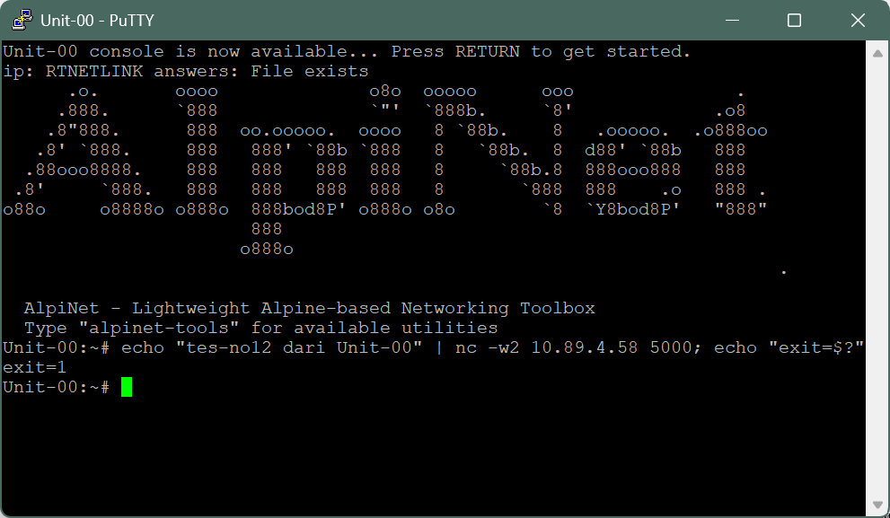

**Setelah listener dinyalakan ulang**: nc dari Unit-00 ke Casper port 5000 berhasil, `exit=0`.

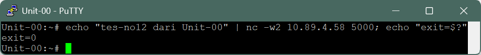

**Kondisi Casper setelah perbaikan**:
- `apt-get update` berhasil (`Reading package lists...` tanpa `Failed to fetch`).
- Ping ke 8.8.8.8 berhasil, 0% packet loss.
- Policy INPUT tetap DROP. Counter rule: `ESTABLISHED,RELATED` 22 paket, `tcp dpt:5000` 3 paket.
- Baris `nc.traditional: not found` di log menunjukkan paket `netcat-traditional` hilang setelah container restart, sehingga loop listener memakai `nc` cadangan.

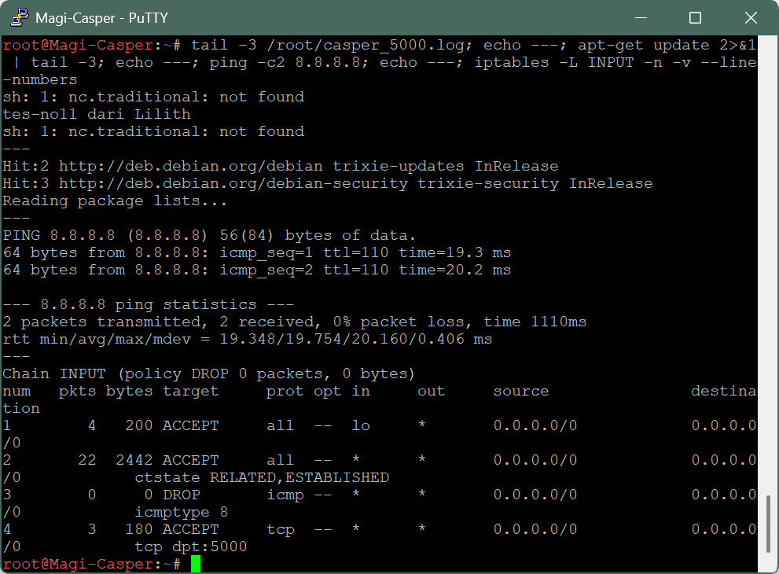

**Ping dari Balthasar ke Casper tetap gagal** (100% packet loss), jadi tujuan hardening tidak dibatalkan.

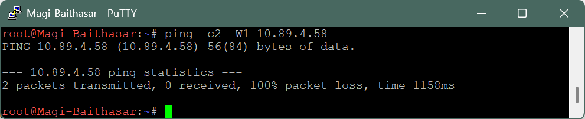

---

## Soal 13 — Brankas Balthasar (`Magi-Balthasar`)

### Konsep

| Pengakses | IP | TCP 5000 & 5001 |
|---|---|---|
| Magi-Casper | 10.89.4.58 | diizinkan |
| Pilot: Unit-01, Unit-02, Unit-00 | 10.89.4.66, .67, .68 | diizinkan |
| Pilot: Sachiel | 10.89.3.130 | diizinkan |
| Node lain, termasuk Melchior yang satu switch | – | **REJECT** |

| Keputusan | Alasan |
|---|---|
| Rule dipasang di **Balthasar sendiri** | Melchior dan Casper satu switch dengan Balthasar, sehingga koneksi mereka tidak melewati router. |
| Target **`REJECT --reject-with tcp-reset`**, bukan DROP | Soal meminta node lain **langsung ditolak**, bukan dibiarkan menggantung. Dengan DROP, pengirim tidak mendapat jawaban dan `nc` menunggu sampai timeout. Dengan tcp-reset, Balthasar langsung membalas RST, sehingga koneksi gagal seketika (`Connection refused`). |
| Policy INPUT tetap **ACCEPT**, rule hanya mengenai `tcp --dports 5000,5001` | Lalu lintas lain tidak boleh terganggu, misalnya ping ke 8.8.8.8 dan balasannya. |
| Memakai **chain khusus `VAULT`** | Semua aturan brankas terkumpul di satu chain. Script cukup mengosongkan lalu mengisi ulang chain ini, jadi aman dijalankan berulang tanpa membuat rule dobel. |

### Script `/root/no13.sh` (Magi-Balthasar)

```bash
#!/bin/bash
ALLOWED="10.89.4.58 10.89.4.66 10.89.4.67 10.89.4.68 10.89.3.130"
#        Casper     Unit-01    Unit-02    Unit-00    Sachiel

iptables -N VAULT 2>/dev/null || iptables -F VAULT
for ip in $ALLOWED; do
  iptables -A VAULT -s $ip -j ACCEPT
done
iptables -A VAULT -p tcp -j REJECT --reject-with tcp-reset

iptables -C INPUT -p tcp -m multiport --dports 5000,5001 -j VAULT 2>/dev/null \
  || iptables -I INPUT 1 -p tcp -m multiport --dports 5000,5001 -j VAULT

iptables -L INPUT -n -v --line-numbers
iptables -L VAULT -n -v --line-numbers
```

### Bukti

**Unit-01 (Pilot) berhasil** menyambung ke port 5000 dan 5001 (`exit=0`).

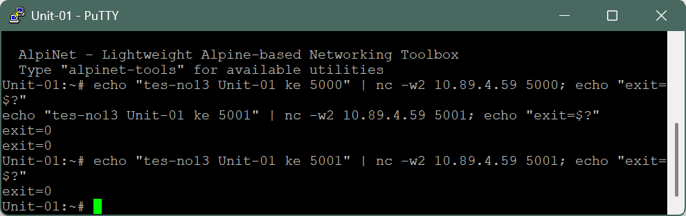

**Lilith ditolak seketika** di kedua port. Durasinya hanya **0.003 detik** (`exit=1`), padahal batas tunggu `-w5` adalah 5 detik. Artinya koneksi langsung ditolak, bukan menggantung.

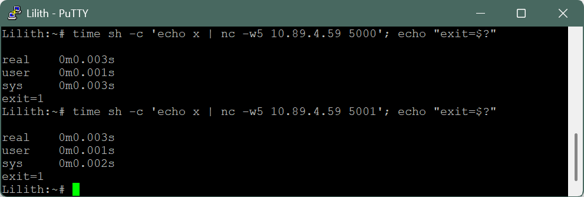

**Melchior (satu switch dengan Balthasar) ditolak seketika**: `Connection refused` dalam 0.004 detik di port 5000 dan 5001.

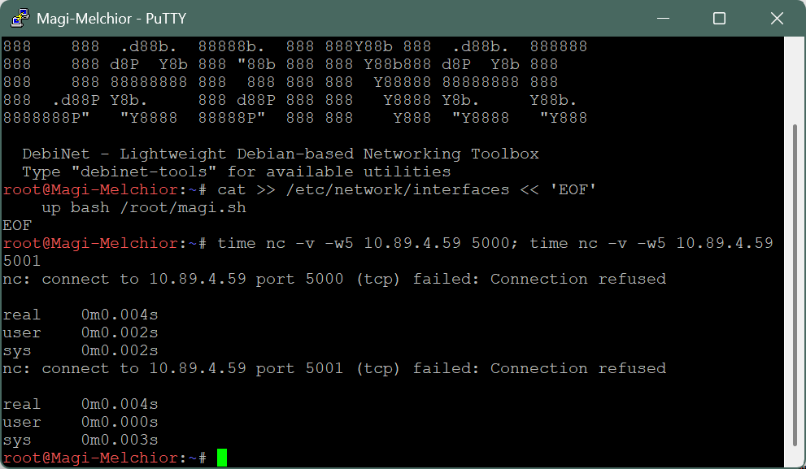

**Sisi Balthasar**:
- Pesan dari Unit-01 tercatat di `balthasar_5000.log` dan `balthasar_5001.log`.
- Ping ke 8.8.8.8 tetap berhasil (0% packet loss), jadi lalu lintas lain tidak terganggu.
- Counter chain `VAULT`: rule ACCEPT `10.89.4.66` (Unit-01) mencatat 15 paket, dan rule REJECT mencatat **4 paket** (2 dari Lilith + 2 dari Melchior).

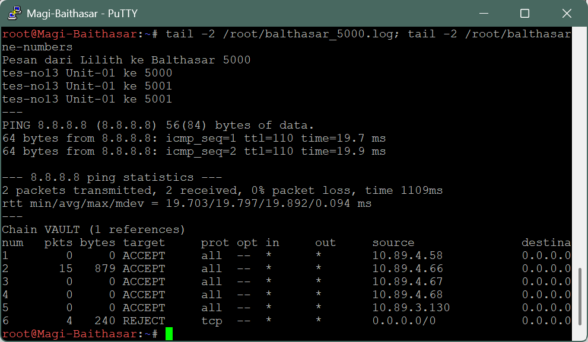

---

## Soal 14 — Jam kunjungan sang pinguin (`Pen-Pen`)

### Konsep

| Kelompok | Anggota (IP) | Jadwal WIB | Jadwal UTC (dibaca iptables) |
|---|---|---|---|
| Pilot | Unit-01 `.66`, Unit-02 `.67`, Unit-00 `.68`, Sachiel `10.89.3.130` | Senin–Jumat 08.00–16.00 | Mon–Fri 01:00–09:00 |
| Staf Geofront | Lilith `.74`, Adam `.75` | Setiap hari 17.00–23.00 | 10:00–16:00 |
| Terduga Dummy System | Entry-Plug `.50`, Dummy-Plug `.51`, Spy `.102` | Tidak pernah | selalu REJECT |
| Lainnya | node lain | Bebas | tidak dibatasi |

- Rule dipasang di **Pen-Pen sendiri** (`10.89.3.195`), karena jadwal berlaku "dari mana pun asalnya", termasuk Medic-Bay yang satu switch.
- Hanya **ping masuk (echo-request)** dan **TCP 80** yang diarahkan ke chain khusus `PENPEN`. Lalu lintas lain tidak tersentuh.
- Di dalam chain, setiap IP Pilot/Staf punya dua rule:
  - `ACCEPT` dengan `-m time` selama masih dalam jadwal.
  - `REJECT` di luar jadwal.
  - Dummy selalu `REJECT`.
  - "Lainnya" tidak terkena rule apa pun, sehingga kembali ke `INPUT` dan diterima oleh policy ACCEPT.
- **Jam komputer tidak diubah.** Jadwal disimpan sebagai variabel WIB di awal script (`PILOT_START`, `PILOT_STOP`, `PILOT_DAYS`, `STAF_START`, `STAF_STOP`), lalu script mengonversinya ke UTC (dikurangi 7 jam), karena modul `time` iptables membaca jam UTC.

### Script `/root/no14.sh` (Pen-Pen)

```bash
#!/bin/bash
# ===== Jadwal (WIB). Bisa di-override: PILOT_START=13:00 bash /root/no14.sh =====
PILOT_START="${PILOT_START:-08:00}"
PILOT_STOP="${PILOT_STOP:-16:00}"
PILOT_DAYS="${PILOT_DAYS:-Mon,Tue,Wed,Thu,Fri}"
STAF_START="${STAF_START:-17:00}"
STAF_STOP="${STAF_STOP:-23:00}"

PILOT_IPS="10.89.4.66 10.89.4.67 10.89.4.68 10.89.3.130"   # Unit-01, Unit-02, Unit-00, Sachiel
STAF_IPS="10.89.4.74 10.89.4.75"                           # Lilith, Adam
DUMMY_IPS="10.89.4.50 10.89.4.51 10.89.4.102"              # Entry-Plug, Dummy-Plug, Spy

# iptables -m time membaca UTC (WIB - 7 jam)
to_utc() { local h=${1%%:*} m=${1##*:}; h=$(( (10#$h - 7 + 24) % 24 )); printf "%02d:%s" "$h" "$m"; }
P_START=$(to_utc $PILOT_START); P_STOP=$(to_utc $PILOT_STOP)
S_START=$(to_utc $STAF_START);  S_STOP=$(to_utc $STAF_STOP)

iptables -N PENPEN 2>/dev/null || iptables -F PENPEN
for ip in $DUMMY_IPS; do iptables -A PENPEN -s $ip -j REJECT; done
for ip in $PILOT_IPS; do
  iptables -A PENPEN -s $ip -m time --timestart $P_START --timestop $P_STOP --weekdays $PILOT_DAYS -j ACCEPT
  iptables -A PENPEN -s $ip -j REJECT
done
for ip in $STAF_IPS; do
  iptables -A PENPEN -s $ip -m time --timestart $S_START --timestop $S_STOP -j ACCEPT
  iptables -A PENPEN -s $ip -j REJECT
done

iptables -C INPUT -p icmp --icmp-type echo-request -j PENPEN 2>/dev/null || iptables -I INPUT 1 -p icmp --icmp-type echo-request -j PENPEN
iptables -C INPUT -p tcp --dport 80 -j PENPEN 2>/dev/null || iptables -I INPUT 2 -p tcp --dport 80 -j PENPEN
```

### Catatan jam server

Jam container di server GNS3 **tidak sama** dengan jam laptop praktikan. Saat pengujian (±14.20 WIB di laptop), `date -u` di Pen-Pen menunjukkan **11:30 UTC**, atau 18:30 WIB menurut server. Karena iptables memakai jam server, nilai uji untuk kondisi "cocok" dan "tidak cocok" disesuaikan dengan jam server tersebut. Jam komputer tidak diubah.

Akibatnya, dengan **jadwal asli** (Pilot 08.00–16.00 WIB), ping Unit-01 ditolak, karena menurut server saat itu sudah pukul 18.30 WIB:

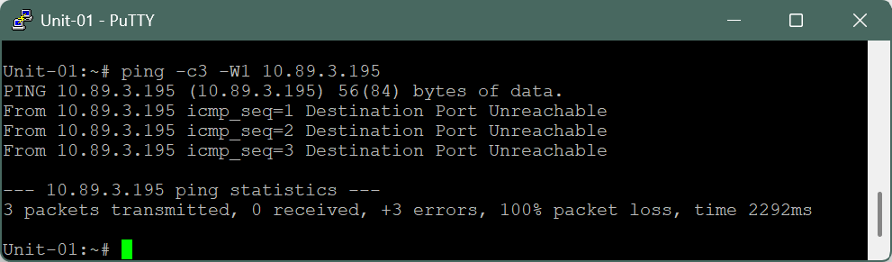

### Pengujian

Variabel di-override dari command line tanpa mengedit file. Jendela jadwal dibuat dari jam server:

```bash
# Kondisi A — COCOK: jendela = jam server (WIB) sekarang
H=$(date -u -d '+7 hour' +%H); S=$(printf "%02d:00" $((10#$H))); E=$(printf "%02d:59" $((10#$H))); D=$(date -u -d '+7 hour' +%a)
PILOT_START=$S PILOT_STOP=$E PILOT_DAYS=$D STAF_START=$S STAF_STOP=$E bash /root/no14.sh

# Kondisi B — TIDAK COCOK: jendela digeser 3 jam ke belakang
H=$(date -u -d '+4 hour' +%H); S=$(printf "%02d:00" $((10#$H))); E=$(printf "%02d:59" $((10#$H))); D=$(date -u -d '+7 hour' +%a)
PILOT_START=$S PILOT_STOP=$E PILOT_DAYS=$D STAF_START=$S STAF_STOP=$E bash /root/no14.sh
```

Setelah pengujian, jadwal dikembalikan ke nilai asli soal dengan `bash /root/no14.sh`.

| Node | Kondisi A (cocok) | Kondisi B (tidak cocok) |
|---|---|---|
| Unit-01 (Pilot) | berhasil, 0% loss | ditolak (`Destination Port Unreachable`) |
| Lilith (Staf) | berhasil, 0% loss | ditolak |
| Spy (Dummy) | ditolak | ditolak |

### Bukti

**Kondisi A — Unit-01 berhasil:**

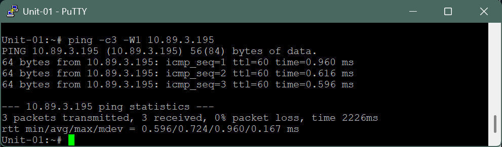

**Kondisi A — Lilith berhasil:**

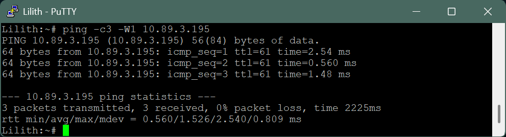

**Spy ditolak di kedua kondisi.** Ping pertama dijalankan saat kondisi A, ping kedua saat kondisi B:

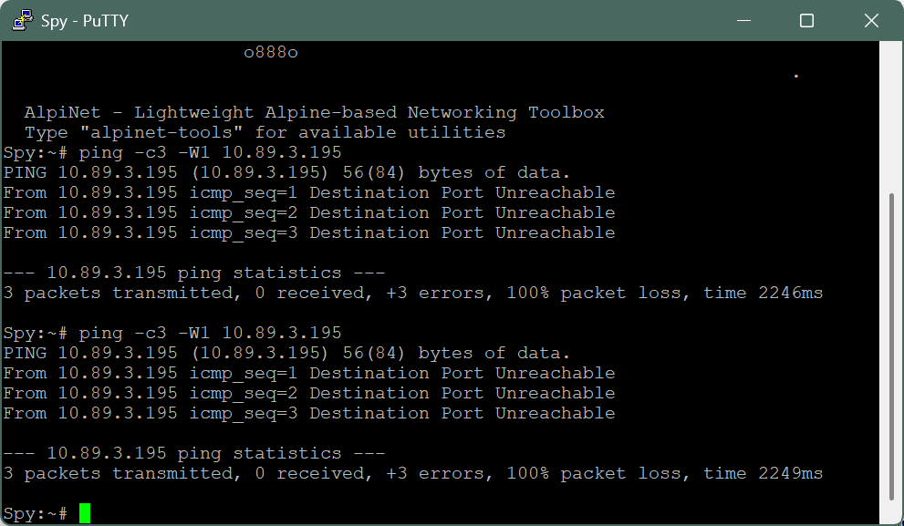

**Kondisi B — Unit-01 ditolak:**

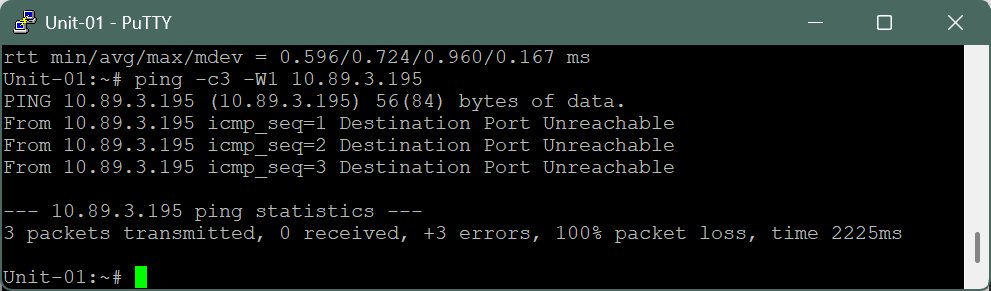

**Kondisi B — Lilith ditolak:**

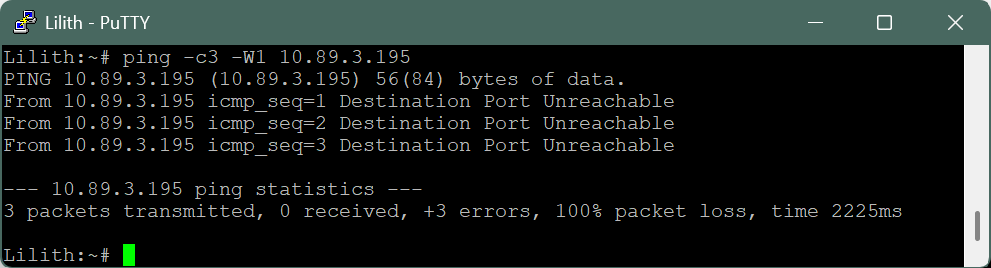

**Counter chain `PENPEN` pada kondisi B.** Jendela jadwal `08:00–08:59 UTC` (15.00–15.59 WIB) tidak mencakup jam server. Rule `REJECT` untuk Spy (`.102`), Unit-01 (`.66`), dan Lilith (`.74`) masing-masing mencatat **3 paket**, sedangkan semua rule `ACCEPT` tetap 0.

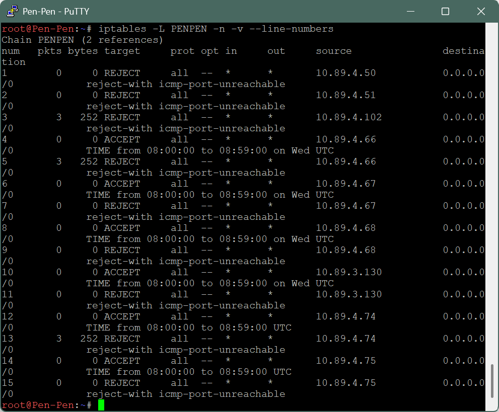

---

## Soal 15 — Banjir ping di pusat komando (`Tokyo3-Core`)

### Konsep

Batas dipasang di **Tokyo3-Core** (`10.89.4.106`) dengan modul `limit` dan dua rule berurutan di chain khusus `PINGLIMIT`:

1. `-m limit --limit 5/second --limit-burst 5 -j ACCEPT`: ping yang masih dalam jatah dijawab.
2. `-j DROP`: kelebihannya dibuang.

Soal meminta "periksa urutan rule dan jenis paketnya". Ada tiga jebakan yang dihindari:

| Jebakan | Akibat kalau salah | Penyelesaian |
|---|---|---|
| Hanya memasang `limit ... -j ACCEPT` tanpa rule DROP | Paket yang melebihi jatah tidak cocok dengan rule apa pun, lalu jatuh ke **policy ACCEPT** dan tetap dijawab. Batasnya tidak berfungsi. | Rule `DROP` dipasang tepat setelah rule `limit`. |
| Membatasi **semua ICMP** | Echo-reply dari ping yang dikirim Tokyo3-Core sendiri ikut dibatasi. | Yang diarahkan ke `PINGLIMIT` hanya `--icmp-type echo-request` yang **masuk**. |
| Rule diletakkan di bawah rule lain yang menerima ICMP | Ping sudah diterima sebelum sampai ke rule limit. | Jump ke `PINGLIMIT` dipasang di **posisi 1** chain `INPUT`. |

Dipakai `limit` (jatah **global**), bukan `hashlimit` (jatah per pengirim), karena soal membatasi Tokyo3-Core agar hanya **menjawab maksimal 5 ping per detik secara keseluruhan**.

Rule soal 16 (LOG + REJECT TCP dari Dummy-Plug) tetap berada di chain `INPUT`. Karena soal 15 hanya mengenai ICMP dan soal 16 hanya mengenai TCP, keduanya tidak saling memengaruhi.

### Script `/root/no15.sh` (Tokyo3-Core)

```bash
#!/bin/bash
iptables -N PINGLIMIT 2>/dev/null || iptables -F PINGLIMIT
iptables -A PINGLIMIT -m limit --limit 5/second --limit-burst 5 -j ACCEPT   # dalam jatah -> jawab
iptables -A PINGLIMIT -j DROP                                              # kelebihan -> buang

iptables -C INPUT -p icmp --icmp-type echo-request -j PINGLIMIT 2>/dev/null \
  || iptables -I INPUT 1 -p icmp --icmp-type echo-request -j PINGLIMIT

iptables -L INPUT -n -v --line-numbers
iptables -L PINGLIMIT -n -v --line-numbers
```

### Bukti

**Ping rapat dari Lilith** (`ping -i 0.1 -c50`, sekitar 10 ping/detik): 50 paket dikirim, **30 diterima, 40% packet loss**.

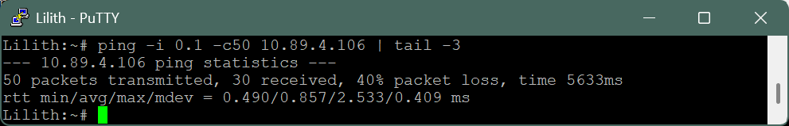

**Counter `PINGLIMIT` di Tokyo3-Core.** Rule `DROP` mencatat **20 paket**, sama persis dengan jumlah ping yang hilang. Rule `ACCEPT` mencatat 30 paket, yaitu burst 5 ditambah sekitar 5 paket/detik selama ±5,6 detik pengujian.

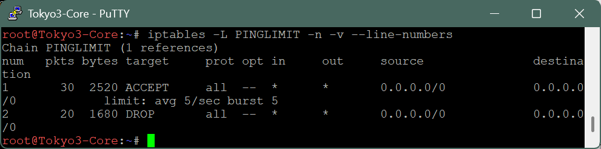

**Ping biasa dari Lilith setelah jeda 3 detik** (`sleep 3; ping -c5`, 1 ping/detik): 5/5 berhasil, 0% packet loss. Aturan ini tidak mengganggu ping di bawah batas.


**Ping yang dikirim Tokyo3-Core sendiri tidak dibatasi.** Ping rapat dari Tokyo3-Core ke Lilith (`-i 0.1 -c30`): 30/30 berhasil, 0% packet loss, karena echo-reply yang masuk tidak diarahkan ke `PINGLIMIT`.


---

## Soal 16 — Pencuri yang Mencoba Setiap Pintu (`Tokyo3-Core`)

### Alur Pengerjaan
1. Membuat dan menjalankan script `/root/firewall_tokyo3.sh` di **Tokyo3-Core (`10.89.4.106`)** untuk mendeteksi dan menolak percobaan akses TCP dari **Dummy-Plug (`10.89.4.51`)** ke port **22, 23, dan 3306**.
2. Setiap paket yang cocok dicatat lebih dulu ke log kernel dengan prefix **`SCAN-NERV: `**, lalu langsung ditolak dengan **`REJECT --reject-with tcp-reset`** supaya pengirim langsung mendapat `Connection refused` dan tidak menggantung sampai timeout.
3. Port layanan HTTP **TCP 80** dan **TCP 8080** tidak dimasukkan ke rule tersebut sehingga tetap bisa diakses oleh Dummy-Plug maupun node lain.
4. Menguji koneksi `nc` dari **Dummy-Plug (`10.89.4.51`)** ke port `22`, `23`, `3306`, `80`, dan `8080`, lalu mengecek counter paket di `iptables -L INPUT -v -n` pada **Tokyo3-Core**.

### Script `/root/firewall_tokyo3.sh` (Tokyo3-Core)
```bash
#!/bin/sh
# Hapus rule lama supaya tidak dobel saat dijalankan ulang
iptables -D INPUT -s 10.89.4.51 -p tcp -m multiport --dports 22,23,3306 -j LOG --log-prefix "SCAN-NERV: " 2>/dev/null
iptables -D INPUT -s 10.89.4.51 -p tcp -m multiport --dports 22,23,3306 -j REJECT --reject-with tcp-reset 2>/dev/null

# Pasang LOG lalu REJECT di chain INPUT
iptables -I INPUT 1 -s 10.89.4.51 -p tcp -m multiport --dports 22,23,3306 -j LOG --log-prefix "SCAN-NERV: "
iptables -I INPUT 2 -s 10.89.4.51 -p tcp -m multiport --dports 22,23,3306 -j REJECT --reject-with tcp-reset
```

### Bukti

**Uji akses port `22`, `23`, `3306` (ditolak seketika, `Exit: 1`) serta `80` dan `8080` (berhasil) dari `Dummy-Plug`:**


**Counter rule `LOG ("SCAN-NERV: ")` dan `REJECT` di `Tokyo3-Core` (`iptables -L INPUT -v -n`):**  
Masing-masing mencatat **6 paket / 360 byte** dari `10.89.4.51`.


---

## Soal 17 — Sihir Hitam di Jalur Paket (Pengalihan Transparan di `Fuyutsuki`)

### Alur Pengerjaan
1. Menyalakan listener Netcat di port **TCP 9000** pada **Zeruel (`10.89.4.82`)** (log ke `/root/zeruel_9000.log`) dan **Pen-Pen (`10.89.3.195`)** (log ke `/root/penpen_9000.log`).
2. Membuat dan menjalankan script `/root/fuyutsuki_nat.sh` di router **Fuyutsuki** untuk membelokkan setiap koneksi **TCP** dari **Magi-Casper (`10.89.4.58`)** yang menuju **Zeruel (`10.89.4.82`)** supaya masuk ke **Pen-Pen (`10.89.3.195`)**:
   - **`PREROUTING` (`DNAT`):** Mengubah IP tujuan paket TCP dari `10.89.4.82` menjadi `10.89.3.195`. Karena rule hanya memfilter `-p tcp`, paket ICMP (`ping`) dari Casper ke Zeruel tetap lurus ke Zeruel.
   - **`POSTROUTING` (`MASQUERADE`):** Memastikan paket yang dibelokkan ke `Pen-Pen` melewati `Fuyutsuki` saat balik dan IP sumber balasannya ditulis ulang menjadi `10.89.4.82` oleh conntrack, sehingga Casper mengira ia berbicara dengan Zeruel.
3. Mengirim pesan lewat `nc` dan melakukan `ping` dari **Magi-Casper** ke `10.89.4.82`, mengecek log di **Pen-Pen** dan **Zeruel**, serta melihat tabel `conntrack` di **Fuyutsuki**.

### Script `/root/fuyutsuki_nat.sh` (Fuyutsuki)
```bash
#!/bin/sh
(command -v iptables >/dev/null 2>&1 || (apt-get update -qq && apt-get install -y -qq iptables conntrack)) 2>/dev/null

# Hapus rule lama supaya tidak dobel
iptables -t nat -D PREROUTING -s 10.89.4.58 -d 10.89.4.82 -p tcp -j DNAT --to-destination 10.89.3.195 2>/dev/null
iptables -t nat -D POSTROUTING -s 10.89.4.58 -d 10.89.3.195 -p tcp -j MASQUERADE 2>/dev/null

# Belokkan koneksi TCP dari Magi-Casper (10.89.4.58) ke Zeruel (10.89.4.82) menuju Pen-Pen (10.89.3.195)
iptables -t nat -A PREROUTING -s 10.89.4.58 -d 10.89.4.82 -p tcp -j DNAT --to-destination 10.89.3.195
iptables -t nat -A POSTROUTING -s 10.89.4.58 -d 10.89.3.195 -p tcp -j MASQUERADE
```

### Bukti

**Pengiriman pesan TCP 9000 dan ping dari `Magi-Casper` ke `Zeruel (10.89.4.82)`:**  
Ping tetap dijawab oleh Zeruel (`0% packet loss`).


**Isi log di `Pen-Pen` (`/root/penpen_9000.log`) dan `Zeruel` (`/root/zeruel_9000.log`):**  
`Pesan rahasia dari Casper untuk Zeruel` masuk ke Pen-Pen, sedangkan di Zeruel tidak ada pesan yang masuk.


**Instalasi `conntrack` dan tabel `conntrack -L` di `Fuyutsuki`:**


**Entri translasi TCP 9000 di `Fuyutsuki` (`conntrack -L -p tcp`):**  
Terlihat koneksi asli `src=10.89.4.58 dst=10.89.4.82 dport=9000` dengan balasan dari `src=10.89.3.195 dst=10.89.4.125 sport=9000`.


---

## Soal 18 — Gerbang Monolith dan Radar (`Shigeru`)

### Alur Pengerjaan
1. Mengamankan zona di bawah **Shigeru** (**Switch-Monolith** di `eth1` dan **Switch-Radar / Makoto** di `eth2`) menggunakan script `/root/shigeru_fw.sh` dengan policy `FORWARD DROP`.
2. Mengizinkan paket balasan dari koneksi yang sudah ada (`--ctstate ESTABLISHED,RELATED`) serta mengizinkan semua koneksi baru yang dimulai dari dalam zona (`-i eth1` dan `-i eth2`) ke luar.
3. Membuka satu pengecualian dari arah luar (`-i eth0`), yaitu `ping` (`ICMP echo-request`) dari subnet **Terminal (`10.89.4.56/29`)**, lalu memblokir semua koneksi masuk lainnya berdasarkan interface datangnya (`-i eth0 -j DROP`) tanpa menuliskan daftar subnet luar satu per satu.
4. Menguji `ping`: **Magi-Casper (`10.89.4.58`)** ke **Zeruel (`10.89.4.82`)** berhasil, **Lilith (`10.89.4.74`)** ke **Zeruel** gagal (`100% packet loss`), dan **Zeruel** ke **Lilith** berhasil.

### Script `/root/shigeru_fw.sh` (Shigeru)
```bash
#!/bin/sh
iptables -F FORWARD
iptables -P FORWARD DROP

# 1. Izinkan paket balasan dari koneksi yang sudah ada
iptables -A FORWARD -m conntrack --ctstate ESTABLISHED,RELATED -j ACCEPT

# 2. Izinkan node di dalam zona (Switch-Monolith eth1 & Switch-Radar/Makoto eth2) memulai koneksi keluar
iptables -A FORWARD -i eth1 -j ACCEPT
iptables -A FORWARD -i eth2 -j ACCEPT

# 3. Pengecualian masuk dari arah Gendou (eth0): ping dari subnet Terminal (10.89.4.56/29)
iptables -A FORWARD -i eth0 -s 10.89.4.56/29 -p icmp --icmp-type echo-request -j ACCEPT

# 4. Blokir semua koneksi masuk lain dari arah Gendou berdasarkan interface (-i eth0)
iptables -A FORWARD -i eth0 -j DROP
```

### Bukti

**Ping dari `Magi-Casper` (`10.89.4.58`, subnet Terminal) ke `Zeruel` (`10.89.4.82`) berhasil (`0% packet loss`):**


**Ping dari `Lilith` (`10.89.4.74`, subnet Dogma) ke `Zeruel` (`10.89.4.82`) ditolak (`100% packet loss`):**


**Ping dari `Zeruel` (`10.89.4.82`) keluar ke `Lilith` (`10.89.4.74`) berhasil (`0% packet loss`):**


---

## Soal 19 — Hukuman untuk Sang Pengkhianat (Isolasi Total `Armisael`)

### Alur Pengerjaan
1. **Armisael (`10.89.4.83`)** dan **Zeruel (`10.89.4.82`)** berada di satu switch yang sama (**Switch-Monolith**, `10.89.4.80/29`), sehingga komunikasi langsung di antara keduanya berjalan di Layer 2 tanpa melewati router **Shigeru**, sementara soal melarang pemasangan rule di dalam `Armisael`.
2. Isolasi dilakukan dari luar `Armisael` pada dua titik:
   - **Layer 2 (Switch-Monolith di GNS3):** Memutus kabel link antara **Armisael** dan **Switch-Monolith** sehingga Armisael tidak bisa menjangkau tetangga satu switch (`Zeruel`) maupun gateway (`Shigeru`), sedangkan `Zeruel` tetap terhubung ke `Switch-Monolith`.
   - **Layer 3 (Gateway `Shigeru`):** Menambahkan rule `DROP` untuk sumber/tujuan `10.89.4.83` di chain `INPUT` dan `FORWARD` pada **Shigeru**.
3. Menyalakan listener **TCP 9000** di **Zeruel** dan **Lilith**, lalu menguji `ping` dan `nc` dari **Armisael** (semuanya gagal) serta dari **Zeruel** ke **Lilith** dan **Seele (`8.8.8.8:53`)** (tetap berhasil).

### Tambahan Rule di `/root/shigeru_fw.sh`
```bash
# Blokir semua paket dari/ke Armisael (10.89.4.83) di Shigeru
iptables -D INPUT -s 10.89.4.83 -j DROP 2>/dev/null
iptables -D FORWARD -s 10.89.4.83 -j DROP 2>/dev/null
iptables -D FORWARD -d 10.89.4.83 -j DROP 2>/dev/null

iptables -I INPUT 1 -s 10.89.4.83 -j DROP
iptables -I FORWARD 1 -s 10.89.4.83 -j DROP
iptables -I FORWARD 2 -d 10.89.4.83 -j DROP
```

### Bukti

**Pemutusan link `Armisael` dari `Switch-Monolith` di GNS3 (link `Zeruel` tetap terpasang):**


**Uji `ping` dan `nc` dari `Armisael` ke Shigeru (`10.89.4.81`), Zeruel (`10.89.4.82`), Lilith (`10.89.4.74`), dan Seele (`8.8.8.8`) — semuanya gagal (`100% packet loss` / `Host is unreachable`):**


**Uji `ping` dan `nc` dari `Zeruel` ke Seele (`8.8.8.8:53`) dan Lilith (`10.89.4.74:9000`) — semuanya tetap berhasil (`Exit: 0`):**


**Pesan `Halo dari Zeruel` tercatat di `/root/lilith_9000.log` pada `Lilith`:**


---

## Soal 20 — Uji Kebakaran Geofront (Backup & Pemulihan Idempoten)

### Alur Pengerjaan
1. Memilih **3 node** yang mencakup router dan server layanan: **Fuyutsuki** (router cabang & DNAT), **Gendou** (router utama, NAT & firewall), dan **Tokyo3-Core** (server HTTP, rate-limit ping & firewall port scan).
2. Menyimpan seluruh rule `iptables` aktif di tiap node ke file `/root/<nama>.rules` dengan `iptables-save`, dan membuat script pemulihan rute statis yang memakai `ip route replace` supaya **idempoten** (tidak membuat rute dobel atau error `File exists` saat dijalankan berulang).
3. Mengosongkan semua rule `iptables` (`iptables -F && iptables -t nat -F`) dan menghapus rute statis di ketiga node.
4. Menjalankan perintah pemulihan (`iptables-restore < /root/<nama>.rules` diikuti script rute) **dua kali berturut-turut** di tiap node, membandingkan jumlah baris `iptables -S | wc -l` dan `iptables -t nat -S | wc -l` pada Pemulihan 1 dan Pemulihan 2, lalu menguji kembali fungsi jaringan masing-masing node.

### Script Pemulihan Rute pada Ketiga Node

**1. Router `Fuyutsuki` (`/root/fuyutsuki.sh`):**
```bash
#!/bin/sh
ip route replace default via 10.89.4.145 dev eth0
ip route replace 10.89.3.192/27 via 10.89.4.126 dev eth2
ip route replace 10.89.4.72/29 via 10.89.4.154 dev eth3
```

**2. Router `Gendou` (`/root/gendou_route.sh`):**
```bash
#!/bin/sh
# Dibuat otomatis dari rute statis aktif dengan ip route replace
ip route show | grep ' via ' | awk '{print "ip route replace " $0}' > /root/gendou_route.sh
sed -i '1i #!/bin/sh' /root/gendou_route.sh
chmod +x /root/gendou_route.sh
```

**3. Server `Tokyo3-Core` (`/root/tokyo3_route.sh`):**
```bash
#!/bin/sh
ip route replace default via 10.89.4.105 dev eth0
```

### Perbandingan Jumlah Baris Rule (Pemulihan 1 vs Pemulihan 2)
| Node | Peran | `iptables -S \| wc -l` (Pemulihan 1) | `iptables -S \| wc -l` (Pemulihan 2) | `iptables -t nat -S \| wc -l` (Pemulihan 1) | `iptables -t nat -S \| wc -l` (Pemulihan 2) | Hasil Uji Fungsi |
|---|---|:-:|:-:|:-:|:-:|---|
| **Fuyutsuki** | Router | 3 | 3 | 6 | 6 | Rute cabang & rule DNAT/MASQUERADE soal 17 pulih |
| **Gendou** | Router | 10 | 10 | 5 | 5 | 34 baris rute, NAT & firewall DROP pulih (Lilith bisa ping `8.8.8.8`) |
| **Tokyo3-Core** | Server | 9 | 9 | 4 | 4 | Rule `PINGLIMIT` & `SCAN-NERV` pulih (port 22 ditolak, port 80 buka) |

### Bukti

**Pemulihan 2x berturut-turut di `Fuyutsuki` (`iptables -S | wc -l` = 3, `iptables -t nat -S | wc -l` = 6, dan `ip route show`):**


**Pemulihan 2x berturut-turut di `Gendou` (`iptables -S | wc -l` = 10, `iptables -t nat -S | wc -l` = 5, `ip route show | wc -l` = 34):**


**Uji fungsi setelah pemulihan `Gendou` — `Lilith` berhasil ping ke `8.8.8.8` (`0% packet loss`):**


**Pemulihan 2x berturut-turut di `Tokyo3-Core` (`iptables -S | wc -l` = 9, `iptables -t nat -S | wc -l` = 4, dan `ip route show`):**


**Uji fungsi setelah pemulihan `Tokyo3-Core` dari `Dummy-Plug` — port `22` langsung `Connection refused`, port `80` membalas `Welcome to Tokyo3-Core`:**


