# Laporan Praktikum Modul 5 — Komunikasi Data & Jaringan Komputer 2026

**Operation Geofront** · Kelompok **K-51** · Group A

| Nama | NRP | Bagian |
|---|---|---|
| Arrumanta Ekna Luhkinasih | 5027251044 | Soal 1–5, 11–15 |
| Muhammad Hugo Rayandra | 5027251076 | Soal 6–10, 16–20 |

---

## Topologi


- 17 router (image `ardhptr21/debinet`), 17 switch, 1 NAT (NAT1), 25 node.
- Konvensi interface router: **eth0 = ke router atas (parent) / NAT1**, **eth1 = LAN switch sendiri**, **eth2 dst. = router anak**.

Struktur pohon router:

```
Gendou ── NAT1 (eth0), Switch-Cmd (eth1)
├── eth2 Fuyutsuki ── Switch-Terminal
│   ├── eth2 Maya ── Switch-Medic
│   └── eth3 Toji ── Switch-Dogma
├── eth3 Shigeru ── Switch-Monolith
│   └── eth2 Makoto ── Switch-Radar
├── eth4 Misato ── Switch-Cage
├── eth5 Kaji ── Switch-Intel
├── eth6 Asuka ── Switch-Archive
│   ├── eth2 Kensuke ── Switch-Bunker
│   └── eth3 Ritsuko ── Switch-Lab
├── eth7 Hikari ── Switch-Comm
│   └── eth2 Kaworu ── Switch-Relay
└── eth8 Yui ── Switch-Hangar
    ├── eth2 Rei ── Switch-Quarters
    ├── eth3 Shinji ── Switch-Garden
    └── eth4 Mari ── Switch-Dock
```

---

## Soal 1 — Markas tanpa peta (VLSM)

Prefix kelompok: **10.89.0.0**. Total kebutuhan 1196 alamat, sehingga seluruh alokasi muat di **10.89.0.0/21** (terpakai sampai 10.89.4.171).

**Aturan yang dipakai**
- Kebutuhan IP per LAN = jumlah host + 1 gateway + 2 (network & broadcast), lalu dibulatkan ke pangkat 2 terkecil yang muat.
- Link antar-router = /30 (2 router + network + broadcast).
- Urutan alokasi: ukuran terbesar dulu. Kalau ukuran sama: LAN dulu, lalu link, lalu urutan tabel.
- Urutan antar link (tidak ada di tabel soal) mengikuti nomor tabel LAN milik router anak (Rei=1, Hikari=2, Yui=3, …).
- Gateway = IP usable pertama. Node diberi IP berikutnya sesuai urutan nama di gambar (kiri ke kanan).

### Contoh perhitungan satu subnet — Switch-Bunker (Kensuke)

- Host: Sachiel = 55, gateway = 1 → 56 alamat usable dibutuhkan.
- Ditambah network + broadcast → 58 alamat.
- Pangkat 2 terkecil ≥ 58 adalah 64 = 2⁶ → prefix = 32 − 6 = **/26** (netmask 255.255.255.192).
- Alamat sebelumnya yang sudah dipakai berakhir di 10.89.3.127 (Hangar /25), maka Bunker = **10.89.3.128/26**.
- Network 10.89.3.128, gateway 10.89.3.129, Sachiel 10.89.3.130, broadcast 10.89.3.191.
- Usable 62, terpakai 56, sisa 6.

### Tabel LAN

| No | Subnet (gateway) | Network | Prefix | Netmask | Gateway | IP node | Broadcast | Terpakai | Sisa |
|---|---|---|---|---|---|---|---|---|---|
| 1 | Quarters (Rei) | 10.89.0.0 | /23 | 255.255.254.0 | 10.89.0.1 | Quarters .0.2 | 10.89.1.255 | 501 | 9 |
| 2 | Comm (Hikari) | 10.89.2.0 | /24 | 255.255.255.0 | 10.89.2.1 | Comm-Net .2.2 | 10.89.2.255 | 201 | 53 |
| 3 | Hangar (Yui) | 10.89.3.0 | /25 | 255.255.255.128 | 10.89.3.1 | Hangar-Crew .3.2 | 10.89.3.127 | 101 | 25 |
| 4 | Bunker (Kensuke) | 10.89.3.128 | /26 | 255.255.255.192 | 10.89.3.129 | Sachiel .3.130 | 10.89.3.191 | 56 | 6 |
| 5 | Medic (Maya) | 10.89.3.192 | /27 | 255.255.255.224 | 10.89.3.193 | Medic-Bay .194, Pen-Pen .195 | 10.89.3.223 | 27 | 3 |
| 6 | Relay (Kaworu) | 10.89.3.224 | /27 | 255.255.255.224 | 10.89.3.225 | Relay-Node .226 | 10.89.3.255 | 26 | 4 |
| 7 | Garden (Shinji) | 10.89.4.0 | /27 | 255.255.255.224 | 10.89.4.1 | Garden-Staff .4.2 | 10.89.4.31 | 15 | 15 |
| 8 | Dock (Mari) | 10.89.4.32 | /28 | 255.255.255.240 | 10.89.4.33 | Dock-Crew .34 | 10.89.4.47 | 13 | 1 |
| 9 | Lab (Ritsuko) | 10.89.4.48 | /29 | 255.255.255.248 | 10.89.4.49 | Entry-Plug .50, Dummy-Plug .51 | 10.89.4.55 | 6 | 0 |
| 10 | Terminal (Fuyutsuki) | 10.89.4.56 | /29 | 255.255.255.248 | 10.89.4.57 | Casper .58, Balthasar .59, Melchior .60 | 10.89.4.63 | 4 | 2 |
| 11 | Cage (Misato) | 10.89.4.64 | /29 | 255.255.255.248 | 10.89.4.65 | Unit-01 .66, Unit-02 .67, Unit-00 .68 | 10.89.4.71 | 4 | 2 |
| 12 | Dogma (Toji) | 10.89.4.72 | /29 | 255.255.255.248 | 10.89.4.73 | Lilith .74, Adam .75 | 10.89.4.79 | 3 | 3 |
| 13 | Monolith (Shigeru) | 10.89.4.80 | /29 | 255.255.255.248 | 10.89.4.81 | Zeruel .82, Armisael .83 | 10.89.4.87 | 3 | 3 |
| 14 | Radar (Makoto) | 10.89.4.88 | /29 | 255.255.255.248 | 10.89.4.89 | Radar-Array .90 | 10.89.4.95 | 5 | 1 |
| 15 | Archive (Asuka) | 10.89.4.96 | /30 | 255.255.255.252 | 10.89.4.97 | Archive-Vault .98 | 10.89.4.99 | 2 | 0 |
| 16 | Intel (Kaji) | 10.89.4.100 | /30 | 255.255.255.252 | 10.89.4.101 | Spy .102 | 10.89.4.103 | 2 | 0 |
| 17 | Cmd (Gendou) | 10.89.4.104 | /30 | 255.255.255.252 | 10.89.4.105 | Tokyo3-Core .106 | 10.89.4.107 | 2 | 0 |

> Terpakai = jumlah host + gateway. Sisa = usable − terpakai.

### Tabel link antar-router (/30)

| No | Link | Network | IP parent | IP child | Broadcast |
|---|---|---|---|---|---|
| L1 | Yui – Rei | 10.89.4.108/30 | .109 | .110 | .111 |
| L2 | Gendou – Hikari | 10.89.4.112/30 | .113 | .114 | .115 |
| L3 | Gendou – Yui | 10.89.4.116/30 | .117 | .118 | .119 |
| L4 | Asuka – Kensuke | 10.89.4.120/30 | .121 | .122 | .123 |
| L5 | Fuyutsuki – Maya | 10.89.4.124/30 | .125 | .126 | .127 |
| L6 | Hikari – Kaworu | 10.89.4.128/30 | .129 | .130 | .131 |
| L7 | Yui – Shinji | 10.89.4.132/30 | .133 | .134 | .135 |
| L8 | Yui – Mari | 10.89.4.136/30 | .137 | .138 | .139 |
| L9 | Asuka – Ritsuko | 10.89.4.140/30 | .141 | .142 | .143 |
| L10 | Gendou – Fuyutsuki | 10.89.4.144/30 | .145 | .146 | .147 |
| L11 | Gendou – Misato | 10.89.4.148/30 | .149 | .150 | .151 |
| L12 | Fuyutsuki – Toji | 10.89.4.152/30 | .153 | .154 | .155 |
| L13 | Gendou – Shigeru | 10.89.4.156/30 | .157 | .158 | .159 |
| L14 | Shigeru – Makoto | 10.89.4.160/30 | .161 | .162 | .163 |
| L15 | Gendou – Asuka | 10.89.4.164/30 | .165 | .166 | .167 |
| L16 | Gendou – Kaji | 10.89.4.168/30 | .169 | .170 | .171 |

Semua link: terpakai 2, sisa 0.

### Pohon pembagian IP

Subnet yang dilingkari merah adalah jalur **Dummy-Plug → Armisael**:
Lab `10.89.4.48/29` → L9 Asuka–Ritsuko `10.89.4.140/30` → L15 Gendou–Asuka `10.89.4.164/30` → L13 Gendou–Shigeru `10.89.4.156/30` → Monolith `10.89.4.80/29`.


---

## Soal 2 — Geofront gelap gulita (IP interface + IP forwarding)

Semua router dikonfigurasi lewat **Edit network configuration** di GNS3 (tersimpan di `/etc/network/interfaces` dan otomatis diterapkan saat node start). Gendou eth0 memakai **DHCP** dari NAT1. IP forwarding diaktifkan lewat baris `up echo 1 > /proc/sys/net/ipv4/ip_forward` pada eth0 tiap router.

### Contoh konfigurasi — Gendou

```
auto eth0
iface eth0 inet dhcp
    up echo 1 > /proc/sys/net/ipv4/ip_forward

auto eth1
iface eth1 inet static
    address 10.89.4.105
    netmask 255.255.255.252

auto eth2
iface eth2 inet static
    address 10.89.4.145
    netmask 255.255.255.252

auto eth3
iface eth3 inet static
    address 10.89.4.157
    netmask 255.255.255.252

auto eth4
iface eth4 inet static
    address 10.89.4.149
    netmask 255.255.255.252

auto eth5
iface eth5 inet static
    address 10.89.4.169
    netmask 255.255.255.252

auto eth6
iface eth6 inet static
    address 10.89.4.165
    netmask 255.255.255.252

auto eth7
iface eth7 inet static
    address 10.89.4.113
    netmask 255.255.255.252

auto eth8
iface eth8 inet static
    address 10.89.4.117
    netmask 255.255.255.252
```

### Contoh konfigurasi — router cabang (Fuyutsuki)

```
auto eth0
iface eth0 inet static
    address 10.89.4.146
    netmask 255.255.255.252
    up echo 1 > /proc/sys/net/ipv4/ip_forward

auto eth1
iface eth1 inet static
    address 10.89.4.57
    netmask 255.255.255.248

auto eth2
iface eth2 inet static
    address 10.89.4.125
    netmask 255.255.255.252

auto eth3
iface eth3 inet static
    address 10.89.4.153
    netmask 255.255.255.252
```

Router lain mengikuti pola yang sama (eth0 = IP child pada link ke parent, eth1 = gateway LAN, eth2+ = IP parent pada link ke anak), sesuai tabel soal 1.

### Ringkasan IP per router

| Router | eth0 | eth1 | eth2 | eth3 | eth4–eth8 |
|---|---|---|---|---|---|
| Gendou | DHCP (192.168.122.16/24) | 10.89.4.105/30 | 10.89.4.145/30 | 10.89.4.157/30 | .149, .169, .165, .113, .117 (/30) |
| Fuyutsuki | 10.89.4.146/30 | 10.89.4.57/29 | 10.89.4.125/30 | 10.89.4.153/30 | – |
| Maya | 10.89.4.126/30 | 10.89.3.193/27 | – | – | – |
| Toji | 10.89.4.154/30 | 10.89.4.73/29 | – | – | – |
| Shigeru | 10.89.4.158/30 | 10.89.4.81/29 | 10.89.4.161/30 | – | – |
| Makoto | 10.89.4.162/30 | 10.89.4.89/29 | – | – | – |
| Misato | 10.89.4.150/30 | 10.89.4.65/29 | – | – | – |
| Kaji | 10.89.4.170/30 | 10.89.4.101/30 | – | – | – |
| Asuka | 10.89.4.166/30 | 10.89.4.97/30 | 10.89.4.121/30 | 10.89.4.141/30 | – |
| Kensuke | 10.89.4.122/30 | 10.89.3.129/26 | – | – | – |
| Ritsuko | 10.89.4.142/30 | 10.89.4.49/29 | – | – | – |
| Hikari | 10.89.4.114/30 | 10.89.2.1/24 | 10.89.4.129/30 | – | – |
| Kaworu | 10.89.4.130/30 | 10.89.3.225/27 | – | – | – |
| Yui | 10.89.4.118/30 | 10.89.3.1/25 | 10.89.4.109/30 | 10.89.4.133/30 | eth4 10.89.4.137/30 |
| Rei | 10.89.4.110/30 | 10.89.0.1/23 | – | – | – |
| Shinji | 10.89.4.134/30 | 10.89.4.1/27 | – | – | – |
| Mari | 10.89.4.138/30 | 10.89.4.33/28 | – | – | – |

### Bukti `ip -br a` dan IP forwarding

Command yang dijalankan di tiap router:

```bash
hostname; ip -br a; echo "ip_forward = $(cat /proc/sys/net/ipv4/ip_forward)"
```

| | | |
|---|---|---|
| Gendou  | Fuyutsuki  | Maya  |
| Toji  | Shigeru 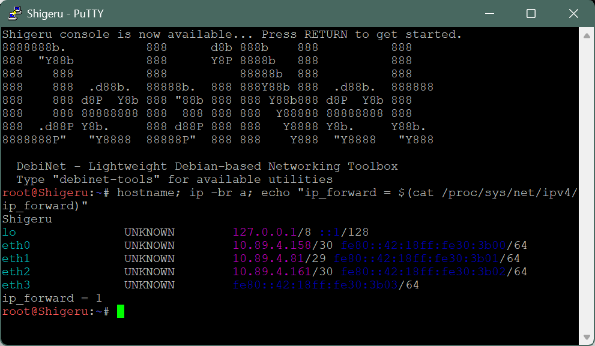 | Makoto  |
| Misato  | Kaji 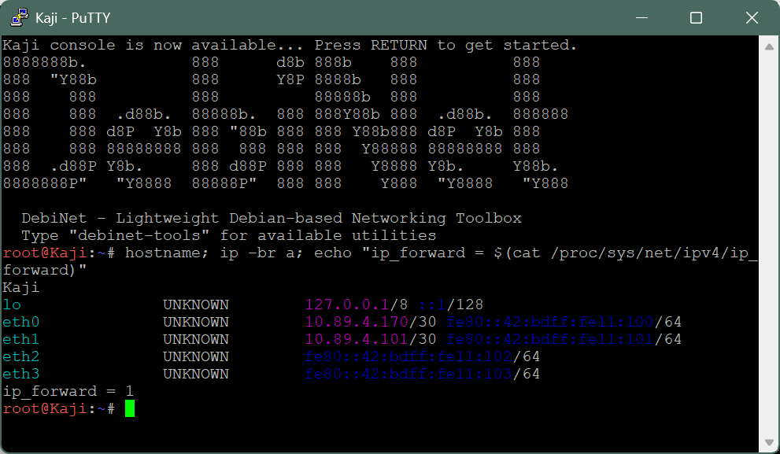 | Asuka  |
| Ritsuko  | Kensuke  | Hikari 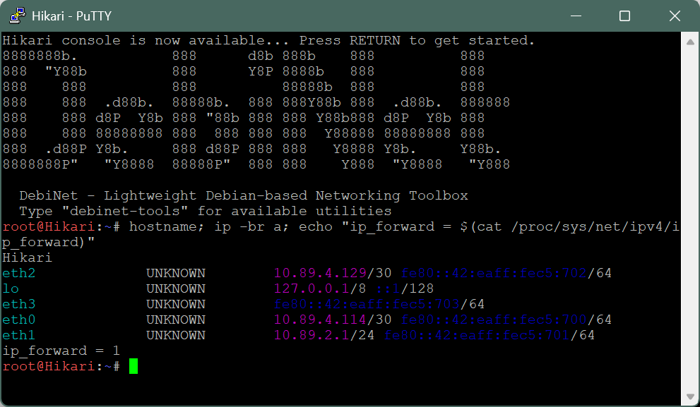 |
| Kaworu  | Yui  | Rei  |
| Shinji  | Mari  | |

Hasil: semua interface terpasang sesuai tabel, Gendou eth0 mendapat `192.168.122.16/24` dari DHCP NAT1, dan `ip_forward = 1` di seluruh router.

### Bukti ping dua ujung tiap link router-ke-router

Dari router parent ke semua router anak, contoh di Gendou:

```bash
echo "### $(hostname)"; for ip in 10.89.4.146 10.89.4.158 10.89.4.150 10.89.4.170 10.89.4.166 10.89.4.114 10.89.4.118; do echo "== ping $ip =="; ping -c2 -W1 $ip | tail -2; done
```

| Router | Target |
|---|---|
| Gendou | 10.89.4.146, .158, .150, .170, .166, .114, .118 |
| Fuyutsuki | 10.89.4.126, .154 |
| Shigeru | 10.89.4.162 |
| Asuka | 10.89.4.122, .142 |
| Hikari | 10.89.4.130 |
| Yui | 10.89.4.110, .134, .138 |

Dari tiap router anak ke parent-nya (IP parent = IP eth0 sendiri − 1):

```bash
MY=$(ip -4 -o addr show eth0 | awk '{print $4}' | cut -d/ -f1); P=${MY%.*}.$(( ${MY##*.} - 1 )); echo "### $(hostname) ($MY) -> parent $P"; ping -c2 -W1 $P | tail -2
```

Hasil: **ke-16 link berhasil di-ping dari kedua ujungnya dengan 0% packet loss.** Router parent (Gendou, Fuyutsuki, Shigeru, Asuka, Hikari, Yui) menjalankan kedua command, sedangkan router ujung hanya menjalankan ping ke parent.

| | | |
|---|---|---|
| Gendou  | Fuyutsuki 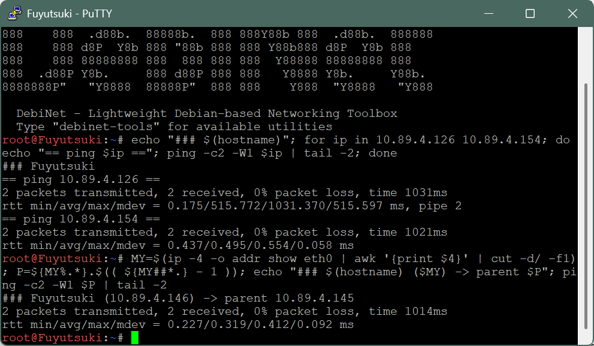 | Maya 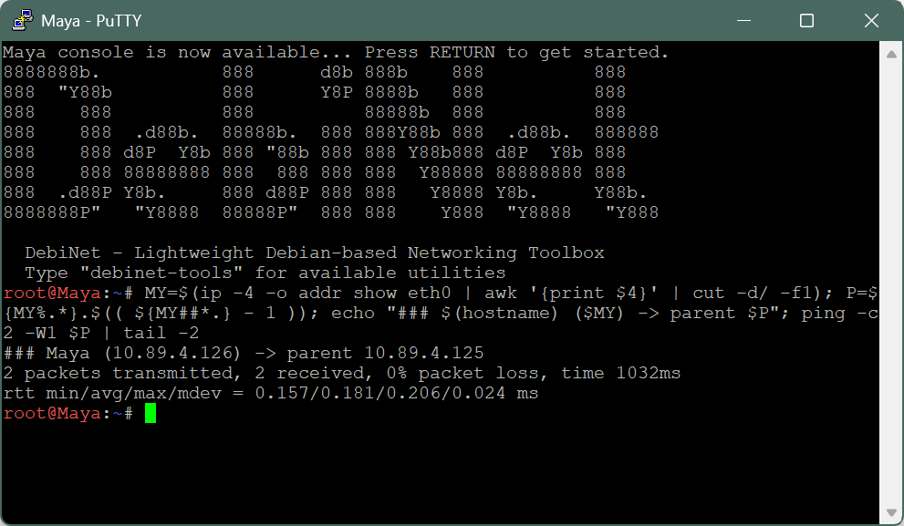 |
| Toji  | Shigeru  | Makoto  |
| Misato  | Kaji  | Asuka 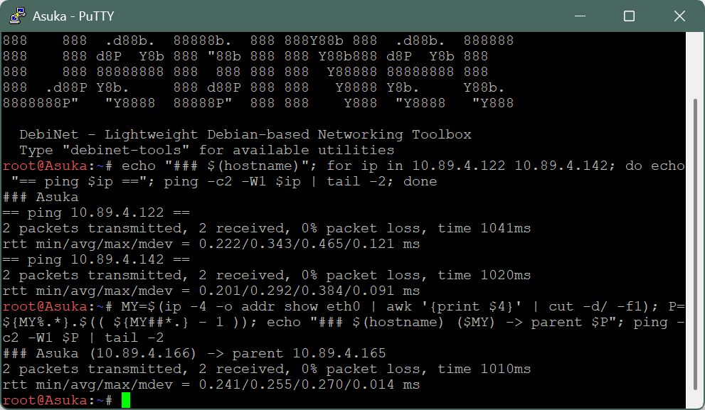 |
| Kensuke  | Ritsuko  | Hikari  |
| Kaworu  | Yui 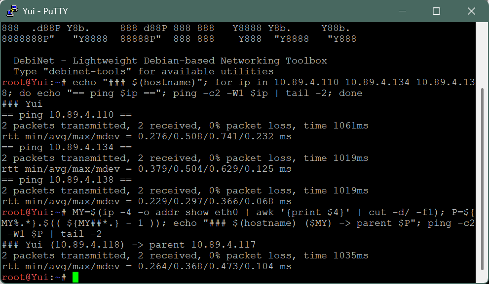 | Rei  |
| Shinji  | Mari  | |

---

## Soal 3 — Pulau-pulau yang terpisah (routing statis)

### Prinsip

Topologi berbentuk **pohon** dengan Gendou sebagai akar, sehingga:

- **Router selain Gendou** cukup punya `default route` ke router atasnya, ditambah rute ke subnet di bawahnya yang **tidak terhubung langsung** (LAN milik router anak).
- **Gendou** memakai default route ke NAT1 (didapat otomatis dari DHCP eth0), ditambah rute ke setiap subnet di tiap cabang yang tidak terhubung langsung.
- Subnet dalam satu cabang yang bisa digabung **tepat** menjadi satu CIDR wajib diringkas.

Analoginya seperti papan petunjuk jalan: di tiap persimpangan cukup ada papan "ke pusat kota → lurus" (default) dan papan khusus untuk kompleks di belakangnya.

### Analisis summarization

Subnet tiap cabang Gendou dicek apakah ada yang bisa digabung tepat menjadi satu CIDR (hasil `ipaddress.collapse_addresses`):

| Cabang | Subnet di cabang (selain link langsung ke Gendou) | Setelah diringkas |
|---|---|---|
| Fuyutsuki | 4.56/29, 3.192/27, 4.72/29, 4.124/30, 4.152/30 | tidak ada yang bisa digabung (5 rute) |
| **Shigeru** | **4.80/29 (Monolith) + 4.88/29 (Radar)**, 4.160/30 | **4.80/28**, 4.160/30 (2 rute) |
| Misato | 4.64/29 | 1 rute |
| Kaji | 4.100/30 | 1 rute |
| Asuka | 4.96/30, 3.128/26, 4.48/29, 4.120/30, 4.140/30 | tidak ada yang bisa digabung (5 rute) |
| Hikari | 2.0/24, 3.224/27, 4.128/30 | tidak ada yang bisa digabung (3 rute) |
| Yui | 0.0/23, 3.0/25, 4.0/27, 4.32/28, 4.108/30, 4.132/30, 4.136/30 | tidak ada yang bisa digabung (7 rute) |

Kenapa Monolith dan Radar bisa digabung: `10.89.4.80/29` (.80–.87) dan `10.89.4.88/29` (.88–.95) bersebelahan, sama besar, dan blok gabungannya `.80–.95` dimulai di kelipatan 16. Jadi tepat membentuk `10.89.4.80/28`, tanpa ada alamat cabang lain yang ikut. Pasangan lain tidak memenuhi syarat itu. Contohnya Garden `4.0/27` dan Dock `4.32/28`: kalau digabung jadi `4.0/26`, Lab `4.48/29` milik cabang Asuka ikut masuk.

### Tabel routing

| Router | Default route | Rute tambahan |
|---|---|---|
| Gendou | via NAT1 (DHCP) | 24 rute ke 7 cabang (lihat `gendo.sh`) |
| Fuyutsuki | 10.89.4.145 | 10.89.3.192/27 via .126 (Maya), 10.89.4.72/29 via .154 (Toji) |
| Shigeru | 10.89.4.157 | 10.89.4.88/29 via .162 (Makoto) |
| Asuka | 10.89.4.165 | 10.89.3.128/26 via .122 (Kensuke), 10.89.4.48/29 via .142 (Ritsuko) |
| Hikari | 10.89.4.113 | 10.89.3.224/27 via .130 (Kaworu) |
| Yui | 10.89.4.117 | 10.89.0.0/23 via .110 (Rei), 10.89.4.0/27 via .134 (Shinji), 10.89.4.32/28 via .138 (Mari) |
| Maya | 10.89.4.125 | – |
| Toji | 10.89.4.153 | – |
| Makoto | 10.89.4.161 | – |
| Misato | 10.89.4.149 | – |
| Kaji | 10.89.4.169 | – |
| Kensuke | 10.89.4.121 | – |
| Ritsuko | 10.89.4.141 | – |
| Kaworu | 10.89.4.129 | – |
| Rei | 10.89.4.109 | – |
| Shinji | 10.89.4.133 | – |
| Mari | 10.89.4.137 | – |

### Script

Rute ditulis di `/root/<nama>.sh` tiap router (salinan lengkap ada di folder [`scripts/soal-3/`](scripts/soal-3/)). Script memakai `ip route replace`, bukan `add`, supaya bisa dijalankan berulang kali tanpa membuat rute dobel atau memunculkan error `File exists`.

`/root/gendo.sh`:

```bash
#!/bin/bash
echo 1 > /proc/sys/net/ipv4/ip_forward
# default route ke NAT1 sudah didapat otomatis dari DHCP eth0
# cabang Fuyutsuki (via 10.89.4.146)
ip route replace 10.89.4.56/29 via 10.89.4.146
ip route replace 10.89.3.192/27 via 10.89.4.146
ip route replace 10.89.4.72/29 via 10.89.4.146
ip route replace 10.89.4.124/30 via 10.89.4.146
ip route replace 10.89.4.152/30 via 10.89.4.146
# cabang Shigeru - Monolith + Radar diringkas jadi 10.89.4.80/28
ip route replace 10.89.4.80/28 via 10.89.4.158
ip route replace 10.89.4.160/30 via 10.89.4.158
# cabang Misato & Kaji
ip route replace 10.89.4.64/29 via 10.89.4.150
ip route replace 10.89.4.100/30 via 10.89.4.170
# cabang Asuka (via 10.89.4.166)
ip route replace 10.89.4.96/30 via 10.89.4.166
ip route replace 10.89.3.128/26 via 10.89.4.166
ip route replace 10.89.4.48/29 via 10.89.4.166
ip route replace 10.89.4.120/30 via 10.89.4.166
ip route replace 10.89.4.140/30 via 10.89.4.166
# cabang Hikari (via 10.89.4.114)
ip route replace 10.89.2.0/24 via 10.89.4.114
ip route replace 10.89.3.224/27 via 10.89.4.114
ip route replace 10.89.4.128/30 via 10.89.4.114
# cabang Yui (via 10.89.4.118)
ip route replace 10.89.3.0/25 via 10.89.4.118
ip route replace 10.89.0.0/23 via 10.89.4.118
ip route replace 10.89.4.0/27 via 10.89.4.118
ip route replace 10.89.4.32/28 via 10.89.4.118
ip route replace 10.89.4.108/30 via 10.89.4.118
ip route replace 10.89.4.132/30 via 10.89.4.118
ip route replace 10.89.4.136/30 via 10.89.4.118
```

Contoh router cabang, `/root/yui.sh`:

```bash
#!/bin/bash
echo 1 > /proc/sys/net/ipv4/ip_forward
ip route replace default via 10.89.4.117
ip route replace 10.89.0.0/23 via 10.89.4.110
ip route replace 10.89.4.0/27 via 10.89.4.134
ip route replace 10.89.4.32/28 via 10.89.4.138
```

### IP sementara node uji

Soal 3 meminta IP dan gateway **sementara** pada node uji (IP permanen dibuat di soal 6). Nilainya disamakan dengan tabel soal 1 supaya tidak bentrok nanti.

| Node | IP | Gateway |
|---|---|---|
| Armisael | 10.89.4.83/29 | 10.89.4.81 |
| Lilith | 10.89.4.74/29 | 10.89.4.73 |
| Sachiel | 10.89.3.130/26 | 10.89.3.129 |
| Comm-Net | 10.89.2.2/24 | 10.89.2.1 |

### Bukti

**Tabel routing Gendou.** Ada default route ke NAT1 (`192.168.122.1`) dari DHCP, rute tiap cabang mengarah ke interface yang benar (eth2 Fuyutsuki, eth3 Shigeru, eth4 Misato, eth5 Kaji, eth6 Asuka, eth7 Hikari, eth8 Yui), dan hasil summarization `10.89.4.80/28 via 10.89.4.158` muncul sebagai satu baris.

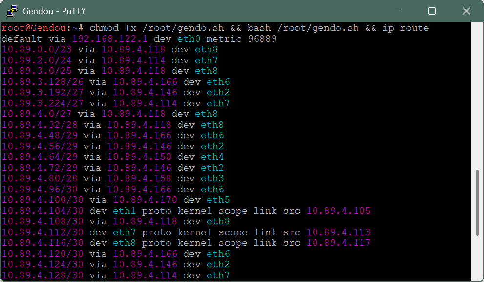

**Ping dari Armisael** ke Lilith (`10.89.4.74`), Sachiel (`10.89.3.130`), dan Comm-Net (`10.89.2.2`): semuanya 3/3 diterima, 0% packet loss.


Jalur yang dilewati, contohnya Armisael → Comm-Net: Armisael → Shigeru (default) → Gendou (`10.89.2.0/24 via 10.89.4.114`) → Hikari (terhubung langsung) → Comm-Net. Balasannya lewat jalur kebalikan: Hikari (default) → Gendou (`10.89.4.80/28 via 10.89.4.158`) → Shigeru → Armisael.

---

## Soal 4 — Haus kabar dari dunia luar (NAT + DNS)

Mulai soal 4, script ditulis **per nomor soal**. Di node namanya `/root/no4.sh`, sedangkan salinannya di repo disimpan per router di [`scripts/soal-4/`](scripts/soal-4/).

### Konsep

Semua node internal memakai IP privat `10.89.x.x` yang tidak dikenal di internet. Gendou menerjemahkan alamat sumbernya menjadi IP eth0 miliknya (alamat dari NAT1) saat paket keluar. Analoginya: semua warga mengirim surat ke luar kota lewat satu kantor pos, dan alamat pengirimnya diganti jadi alamat kantor pos itu. Balasan datang ke kantor pos, lalu diteruskan ke warga yang benar berkat tabel conntrack.

Tiga syarat soal dipenuhi lewat satu rule:

| Syarat soal | Cara memenuhi |
|---|---|
| Tidak perlu diubah saat IP NAT1 berganti | Pakai **`MASQUERADE`**, bukan `SNAT --to-source`. MASQUERADE selalu memakai IP eth0 yang sedang aktif. |
| Hanya traffic dari prefix internal yang diterjemahkan | Pakai `-s 10.89.0.0/21` (seluruh alokasi soal 1). |
| Traffic antar-LAN tetap membawa alamat asli | Pakai `-o eth0`. Rule hanya berlaku untuk paket yang keluar ke NAT1, sedangkan paket antar-LAN keluar lewat eth1–eth8 sehingga tidak tersentuh. |

Untuk DNS, semua router dan node uji diberi `nameserver 192.168.122.1` (DNS dari NAT1) dan `8.8.8.8` sebagai cadangan di `/etc/resolv.conf`, supaya bisa me-resolve nama domain sebelum memasang paket.

### Script

`/root/no4.sh` di **Gendou** ([`scripts/soal-4/gendou.sh`](scripts/soal-4/gendou.sh)):

```bash
#!/bin/bash
cat > /etc/resolv.conf << 'R'
nameserver 192.168.122.1
nameserver 8.8.8.8
R

command -v iptables >/dev/null || { apt-get update && apt-get install -y iptables; }

iptables -t nat -C POSTROUTING -s 10.89.0.0/21 -o eth0 -j MASQUERADE 2>/dev/null \
  || iptables -t nat -A POSTROUTING -s 10.89.0.0/21 -o eth0 -j MASQUERADE

iptables -t nat -L POSTROUTING -n -v --line-numbers
```

`iptables -C ... || iptables -A ...` mengecek dulu apakah rule sudah ada, jadi script bisa dijalankan berulang tanpa membuat rule dobel.

`/root/no4.sh` di **16 router lain** (isinya sama). Router memasang DNS, lalu memasang iptables kalau belum ada. Langkah ini baru bisa dilakukan setelah NAT di Gendou aktif:

```bash
#!/bin/bash
cat > /etc/resolv.conf << 'R'
nameserver 192.168.122.1
nameserver 8.8.8.8
R
command -v iptables >/dev/null || { apt-get update && apt-get install -y iptables; }
cat /etc/resolv.conf
```

Untuk node uji (Armisael, Lilith, Sachiel, Comm-Net), IP, gateway, dan DNS dipasang permanen lewat **Edit network configuration**. Nilainya sama dengan tabel soal 1, sehingga sekaligus memenuhi soal 6 untuk keempat node ini. Contoh Armisael:

```
auto eth0
iface eth0 inet static
    address 10.89.4.83
    netmask 255.255.255.248
    gateway 10.89.4.81
    up echo -e "nameserver 192.168.122.1\nnameserver 8.8.8.8" > /etc/resolv.conf
```

### Bukti

**Armisael**: ping `8.8.8.8` berhasil, `deb.debian.org` ter-resolve (ke `debian.map.fastlydns.net`) dan berhasil di-ping. Semuanya 0% packet loss.

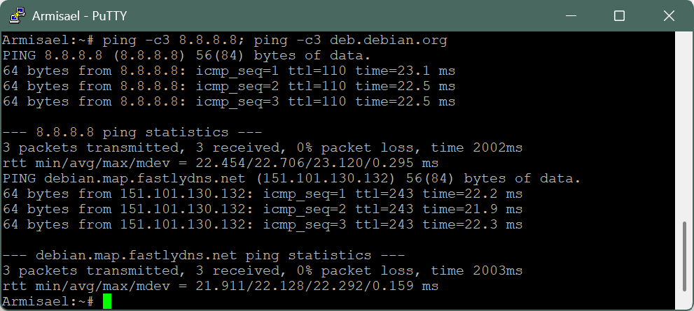

**Lilith**: ping `8.8.8.8` dan `deb.debian.org` berhasil, 0% packet loss.


**Counter rule NAT di Gendou**: rule `MASQUERADE` dengan `out eth0` dan `source 10.89.0.0/21` mencatat **12 paket / 872 byte**. Jadi traffic dari dalam benar-benar diterjemahkan oleh rule ini.


> Counternya kecil walaupun ping-nya banyak karena rule di tabel `nat` hanya dievaluasi untuk **paket pertama tiap koneksi**. Paket berikutnya, termasuk balasannya, diterjemahkan otomatis oleh *connection tracking* tanpa melewati rule lagi. Satu rangkaian ping dihitung satu "koneksi" ICMP, dan satu query DNS dihitung satu koneksi UDP.

**Contoh router lain (Toji)**: `no4.sh` memasang DNS. iptables sudah tersedia di image, jadi tidak perlu di-install.

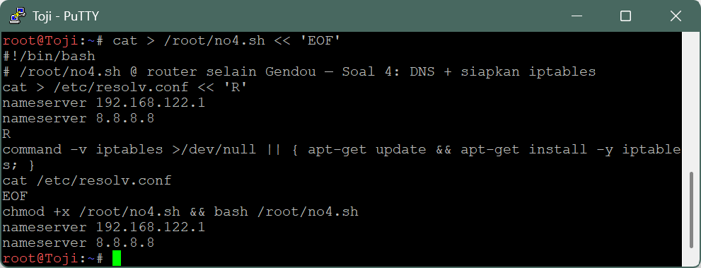

---

## Soal 5 — Pintu depan dikunci rapat (firewall Gendou)

### Konsep

Policy **INPUT** dan **FORWARD** di Gendou diubah menjadi **DROP**, sehingga semua paket yang tidak ada di daftar izin ditolak. Analoginya seperti satpam dengan daftar tamu: yang namanya tidak tercantum tidak boleh masuk.

| Izin yang diminta soal | Chain | Rule |
|---|---|---|
| Loopback | INPUT | `-i lo` |
| (a) Balasan koneksi yang sudah ada | INPUT & FORWARD | `-m conntrack --ctstate ESTABLISHED,RELATED` |
| DHCP dari NAT1 | INPUT | `-i eth0 -p udp --sport 67 --dport 68` |
| (d) Jaringan internal → Gendou sendiri | INPUT | `! -i eth0 -s 10.89.0.0/21` |
| (b) Jaringan internal → internet | FORWARD | `! -i eth0 -s 10.89.0.0/21 -o eth0` |
| (c) Antar-LAN | FORWARD | `! -i eth0 ! -o eth0 -s 10.89.0.0/21 -d 10.89.0.0/21` |

Kenapa "boleh keluar, tidak boleh dimasuki" bisa tercapai: paket dari dalam ke internet lolos lewat rule (b), dan balasannya berstatus **ESTABLISHED** sehingga lolos lewat rule (a). Koneksi yang **dimulai** dari sisi NAT1 berstatus **NEW**, tidak cocok dengan rule mana pun, sehingga dibuang oleh policy DROP.

Kondisi `! -i eth0` dipakai supaya paket dari arah NAT1 tidak bisa menyamar memakai alamat sumber `10.89.x.x` (anti-spoofing).

Di script, semua rule izin dipasang lebih dulu, baru policy diubah ke DROP **paling akhir**. Dengan begitu tidak ada jeda waktu ketika Gendou terkunci total. Script juga mengosongkan chain INPUT dan FORWARD sebelum memasang ulang, sehingga aman dijalankan berulang tanpa membuat rule dobel.

### Script `/root/gendo.sh`

Sesuai permintaan soal, seluruh konfigurasi Gendou untuk soal 2–5 ditulis dalam satu file `gendo.sh`:

```bash
#!/bin/bash
# /root/gendo.sh — Gendou: Soal 2, 3, 4, 5
INTERNAL=10.89.0.0/21
WAN=eth0

# ===== Soal 2: IP forwarding =====
echo 1 > /proc/sys/net/ipv4/ip_forward

# ===== Soal 3: routing statis (default ke NAT1 dari DHCP eth0) =====
ip route replace 10.89.4.56/29 via 10.89.4.146
ip route replace 10.89.3.192/27 via 10.89.4.146
ip route replace 10.89.4.72/29 via 10.89.4.146
ip route replace 10.89.4.124/30 via 10.89.4.146
ip route replace 10.89.4.152/30 via 10.89.4.146
ip route replace 10.89.4.80/28 via 10.89.4.158
ip route replace 10.89.4.160/30 via 10.89.4.158
ip route replace 10.89.4.64/29 via 10.89.4.150
ip route replace 10.89.4.100/30 via 10.89.4.170
ip route replace 10.89.4.96/30 via 10.89.4.166
ip route replace 10.89.3.128/26 via 10.89.4.166
ip route replace 10.89.4.48/29 via 10.89.4.166
ip route replace 10.89.4.120/30 via 10.89.4.166
ip route replace 10.89.4.140/30 via 10.89.4.166
ip route replace 10.89.2.0/24 via 10.89.4.114
ip route replace 10.89.3.224/27 via 10.89.4.114
ip route replace 10.89.4.128/30 via 10.89.4.114
ip route replace 10.89.3.0/25 via 10.89.4.118
ip route replace 10.89.0.0/23 via 10.89.4.118
ip route replace 10.89.4.0/27 via 10.89.4.118
ip route replace 10.89.4.32/28 via 10.89.4.118
ip route replace 10.89.4.108/30 via 10.89.4.118
ip route replace 10.89.4.132/30 via 10.89.4.118
ip route replace 10.89.4.136/30 via 10.89.4.118

# ===== Soal 4: DNS + NAT =====
printf 'nameserver 192.168.122.1\nnameserver 8.8.8.8\n' > /etc/resolv.conf
iptables -t nat -C POSTROUTING -s $INTERNAL -o $WAN -j MASQUERADE 2>/dev/null \
  || iptables -t nat -A POSTROUTING -s $INTERNAL -o $WAN -j MASQUERADE

# ===== Soal 5: firewall =====
iptables -P INPUT ACCEPT
iptables -P FORWARD ACCEPT
iptables -F INPUT
iptables -F FORWARD

iptables -A INPUT -i lo -j ACCEPT
iptables -A INPUT -m conntrack --ctstate ESTABLISHED,RELATED -j ACCEPT          # (a)
iptables -A INPUT -i $WAN -p udp --sport 67 --dport 68 -j ACCEPT                # DHCP
iptables -A INPUT ! -i $WAN -s $INTERNAL -j ACCEPT                              # (d)

iptables -A FORWARD -m conntrack --ctstate ESTABLISHED,RELATED -j ACCEPT        # (a)
iptables -A FORWARD ! -i $WAN -s $INTERNAL -o $WAN -j ACCEPT                    # (b)
iptables -A FORWARD ! -i $WAN ! -o $WAN -s $INTERNAL -d $INTERNAL -j ACCEPT     # (c)

iptables -P INPUT DROP
iptables -P FORWARD DROP

iptables -S
```

### Bukti

**`iptables -S` di Gendou**: policy INPUT dan FORWARD sudah DROP, OUTPUT tetap ACCEPT, dan 7 rule izin terpasang sesuai tabel.

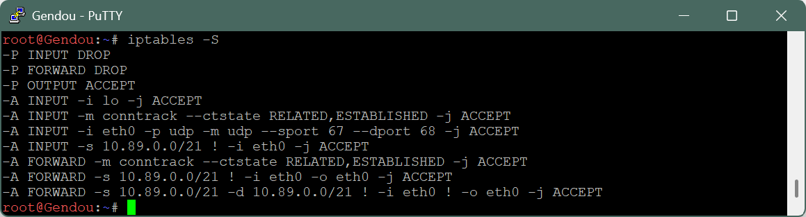

**Armisael tetap bisa ping `8.8.8.8`**: 3/3 diterima, 0% packet loss.

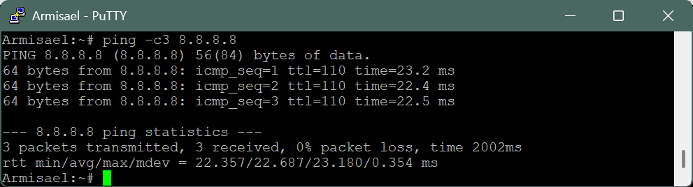

**Soal 2–4 tetap jalan**:
- eth0 Gendou masih memegang IP DHCP `192.168.122.16/24`.
- Gendou sendiri masih bisa ping `8.8.8.8`. Balasannya masuk lewat rule ESTABLISHED di INPUT (counter 4 paket).
- Counter FORWARD: rule (a) ESTABLISHED 23 paket, rule (b) internal → internet 8 paket, rule (c) antar-LAN 2 paket. Artinya traffic internet dan antar-LAN sama-sama lewat rule izin masing-masing.
- Counter policy DROP masih 0: belum ada paket sah yang ikut terbuang.

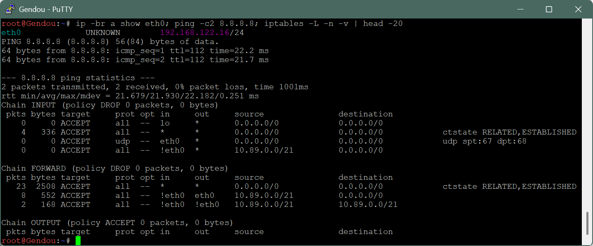

---

## Soal 6 — Konfigurasi IP Permanen pada Seluruh Host

### Alur Pengerjaan
1. Agar seluruh 25 host node (`alpinet` maupun `debinet`) tidak kehilangan alamat IP statis maupun rute *default gateway* setelah container di-*restart*, seluruh konfigurasi antarmuka jaringan dipindahkan dari eksekusi perintah manual (`ip addr` / `ip route`) ke berkas konfigurasi persisten `/etc/network/interfaces`.
2. Struktur konfigurasi yang diterapkan pada tiap host menggunakan parameter `auto eth0` dan `iface eth0 inet static` dengan menyesuaikan IP host, *netmask*, serta *gateway* masing-masing subnet dalam blok jaringan kelompok **K-51** (`10.89.0.0/21`).
3. Setelah berkas disimpan, antarmuka jaringan di-*restart* (`ifdown eth0 && ifup eth0` atau reboot node) dan diverifikasi menggunakan `ip -br a`, `ip route show`, serta `ping` menuju *gateway* masing-masing.

### Contoh Konfigurasi (`/etc/network/interfaces` pada `Unit-01`)
```text
auto lo
iface lo inet loopback

auto eth0
iface eth0 inet static
    address 10.89.4.66
    netmask 255.255.255.248
    gateway 10.89.4.65
```

### Bukti Screenshot
* **Verifikasi IP Permanen & Ping Gateway pada Host (`Unit-01`)**
  

---

## Soal 7 — Mengenali Kondisi Normal: Layanan Internal MAGI

### Alur Pengerjaan
1. Membuat dan mengeksekusi skrip `/root/magi.sh` pada ketiga node MAGI menggunakan *listener* Netcat (`netcat-traditional`) yang berjalan terus-menerus di latar belakang (`nohup ... while true`) dan mencatat seluruh pesan masuk ke file log lokal:
   * **Magi-Casper (`10.89.4.58`)** mendengarkan port **TCP 5000** → `/root/casper_5000.log`
   * **Magi-Balthasar (`10.89.4.59`)** mendengarkan port **TCP 5000** dan **TCP 5001** → `/root/balthasar_5000.log` & `/root/balthasar_5001.log`
   * **Magi-Melchior (`10.89.4.60`)** mendengarkan port **TCP 5000** → `/root/melchior_5000.log`
2. Melakukan pengujian pengiriman pesan dari node **Lilith (`10.89.4.74`)** ke seluruh port layanan MAGI dan memverifikasi isi berkas log di masing-masing server MAGI.

### Isi Script (`/root/magi.sh`)

#### 1. Magi-Casper (`10.89.4.58`)
```bash
#!/bin/bash
apt-get update && apt-get install -y iptables netcat-traditional
pkill -f "nc " 2>/dev/null
touch /root/casper_5000.log
nohup sh -c 'while true; do nc.traditional -l -p 5000 >> /root/casper_5000.log 2>&1 || nc -l 5000 >> /root/casper_5000.log 2>&1; done' >/dev/null 2>&1 &
```

#### 2. Magi-Balthasar (`10.89.4.59`)
```bash
#!/bin/bash
apt-get update && apt-get install -y iptables netcat-traditional
pkill -f "nc " 2>/dev/null
touch /root/balthasar_5000.log /root/balthasar_5001.log
nohup sh -c 'while true; do nc.traditional -l -p 5000 >> /root/balthasar_5000.log 2>&1 || nc -l 5000 >> /root/balthasar_5000.log 2>&1; done' >/dev/null 2>&1 &
nohup sh -c 'while true; do nc.traditional -l -p 5001 >> /root/balthasar_5001.log 2>&1 || nc -l 5001 >> /root/balthasar_5001.log 2>&1; done' >/dev/null 2>&1 &
```

#### 3. Magi-Melchior (`10.89.4.60`)
```bash
#!/bin/bash
apt-get update && apt-get install -y iptables netcat-traditional
pkill -f "nc " 2>/dev/null
touch /root/melchior_5000.log
nohup sh -c 'while true; do nc.traditional -l -p 5000 >> /root/melchior_5000.log 2>&1 || nc -l 5000 >> /root/melchior_5000.log 2>&1; done' >/dev/null 2>&1 &
```

### Bukti Screenshot
* **Log Pesan Masuk di Magi-Casper (`port 5000`)**
  
* **Log Pesan Masuk di Magi-Balthasar (`port 5000` & `5001`)**
  
* **Log Pesan Masuk di Magi-Melchior (`port 5000`)**
  

---

## Soal 8 — Mengenali Kondisi Normal: Layanan HTTP (`Pen-Pen` & `Tokyo3-Core`)

### Alur Pengerjaan
1. Membuat skrip `/root/service.sh` di **Pen-Pen (`10.89.3.195`)** untuk membuka layanan pada port **TCP 80** yang membalas setiap koneksi dengan pesan `Welcome to Pen-Pen`.
2. Membuat skrip `/root/service.sh` di **Tokyo3-Core (`10.89.4.106`)** untuk membuka layanan pada port **TCP 80** (membalas `Welcome to Tokyo3-Core`) dan port **TCP 8080** (membalas `syifa imutz`).
3. Melakukan verifikasi dari **Lilith (`10.89.4.74`)** menggunakan `nc -v -w 2` menuju ketiga port aktif tersebut, sekaligus menguji akses ke port tertutup (**TCP 22**) untuk memastikan koneksi langsung ditolak (*Connection refused*, exit code `1`) dan tidak menggantung (*timeout*).

### Isi Script (`/root/service.sh`)

#### 1. Pen-Pen (`10.89.3.195`)
```bash
#!/bin/bash
if command -v apt-get >/dev/null 2>&1; then
    apt-get update && apt-get install -y iptables netcat-traditional
else
    apk add --no-cache iptables netcat-openbsd
fi
pkill -f "nc.*80" 2>/dev/null
nohup sh -c 'while true; do echo "Welcome to $(hostname)" | nc.traditional -l -p 80 -q 1 2>/dev/null || echo "Welcome to $(hostname)" | nc -l 80 -w 1 2>/dev/null; done' >/dev/null 2>&1 &
```

#### 2. Tokyo3-Core (`10.89.4.106`)
```bash
#!/bin/bash
if command -v apt-get >/dev/null 2>&1; then
    apt-get update && apt-get install -y iptables netcat-traditional
else
    apk add --no-cache iptables netcat-openbsd
fi
pkill -f "nc.*80" 2>/dev/null
nohup sh -c 'while true; do echo "Welcome to $(hostname)" | nc.traditional -l -p 80 -q 1 2>/dev/null || echo "Welcome to $(hostname)" | nc -l 80 -w 1 2>/dev/null; done' >/dev/null 2>&1 &
nohup sh -c 'while true; do echo "syifa imutz" | nc.traditional -l -p 8080 -q 1 2>/dev/null || echo "syifa imutz" | nc -l 8080 -w 1 2>/dev/null; done' >/dev/null 2>&1 &
```

### Bukti Screenshot
* **Pengujian Koneksi dari Lilith ke Pen-Pen (`80`), Tokyo3-Core (`80` & `8080`), dan Port Tertutup (`22`)**
  

---

## Soal 9 — Sabotase 1: Jalur Belakang Diutak-atik (`break_routing.sh` di Shigeru)

### Alur Pengerjaan
1. Mengeksekusi skrip `/root/break_routing.sh` pada router **Shigeru** tanpa membaca isinya terlebih dahulu.
2. Membuktikan gejala kerusakan: `ping` dari **Armisael (`10.89.4.83`)** menuju *gateway*-nya (**Shigeru `10.89.4.81`**) tetap berhasil, sedangkan `ping` dari **Lilith (`10.89.4.74`)** menuju **Armisael (`10.89.4.83`)** gagal total.
3. Melakukan diagnosa menyeluruh pada Shigeru menggunakan `sysctl net.ipv4.ip_forward`, `ip route show`, dan `ip rule show`.
4. Memulihkan seluruh konfigurasi routing Shigeru dan menguji kembali konektivitas dari **Lilith** ke **Armisael** hingga normal (`0% packet loss`).

### Hasil Diagnosa & Penjelasan Penyebab Kerusakan
Skrip `break_routing.sh` merusak jalur routing di **Shigeru** melalui **4 mekanisme** sekaligus:
1. **Mematikan IP Forwarding (`net.ipv4.ip_forward = 0`):** Shigeru berhenti meneruskan paket antar-interface sehingga tidak lagi berfungsi sebagai router.
2. **Membelokkan Default Route ke Arah Salah (`Makoto`):** Rute *default* yang seharusnya menuju *upstream* (**Gendou `10.89.4.157`** via `eth0`) diganti ke arah *downstream* menuju router anak **Makoto (`10.89.4.162`** via `eth2`).
3. **Menambahkan Rute `blackhole` untuk Subnet Dogma (`10.89.4.72/29`):** Seluruh paket balasan dari Shigeru menuju subnet Lilith/Adam langsung dibuang diam-diam oleh kernel tanpa pesan error ICMP.
4. **Policy-Based Routing (`ip rule` + `table 100`):** Skrip menambahkan aturan `iif eth1 lookup 100 priority 90` yang mengarahkan semua paket masuk dari LAN Switch-Monolith ke `table 100` berisi `unreachable default` sebelum sempat membaca tabel routing utama (`main`).

> **Mengapa Armisael tetap bisa ping ke gateway (`10.89.4.81`), tetapi Lilith gagal ping ke Armisael?**  
> Komunikasi antara Armisael (`10.89.4.83`) dan interface `eth1` Shigeru (`10.89.4.81`) berada dalam satu subnet lokal (`10.89.4.80/29`) dan diproses secara lokal oleh router (*input* lokal), sehingga tidak membutuhkan `ip_forward` maupun tabel routing. Sebaliknya, trafik lintas subnet dari Lilith menuju Armisael membutuhkan *forwarding* dan pembacaan tabel routing yang keempat komponennya telah dilumpuhkan.

### Script Perbaikan di Router Shigeru
```bash
#!/bin/sh
# 1. Aktifkan kembali IP forwarding
sysctl -w net.ipv4.ip_forward=1

# 2. Hapus aturan Policy-Based Routing (ip rule priority 90 & table 100)
ip rule del iif eth1 lookup 100 priority 90 2>/dev/null
ip route flush table 100 2>/dev/null

# 3. Hapus rute blackhole menuju subnet Dogma (Lilith)
ip route del blackhole 10.89.4.72/29 2>/dev/null

# 4. Kembalikan default route ke upstream (Gendou 10.89.4.157 via eth0)
ip route replace default via 10.89.4.157 dev eth0
```

### Bukti Screenshot
* **Kondisi Sebelum Perbaikan (Eksekusi `break_routing.sh` & Gejala Ping Gagal)**
  
* **Hasil Diagnosa (`ip route`, `ip rule`, `ip_forward`) di Shigeru**
  
* **Kondisi Setelah Perbaikan (Ping Lilith ke Armisael Berhasil)**
  

---

## Soal 10 — Sabotase 2: Para Pilot Terkunci di Dalam (`break_nat.sh` di Misato & Gendou)

### Alur Pengerjaan
1. Mengeksekusi skrip `/root/break_nat.sh` pada router **Misato** dan router **Gendou**.
2. Membuktikan gejala kerusakan:
   * Dari **Unit-01 (`10.89.4.66` — Switch-Cage)**, `ping 8.8.8.8` gagal total, namun `ping 10.89.4.74` (**Lilith**) tetap berjalan normal.
   * Dari **Spy (`10.89.4.102` — Switch-Intel)**, `ping 8.8.8.8` tetap berjalan normal tanpa gangguan.
3. Memeriksa tabel NAT (`iptables -t nat -S`) pada **Misato** dan **Gendou**, menghapus kedua aturan sabotase, lalu memverifikasi kembali koneksi `ping 8.8.8.8` dari **Unit-01** hingga normal.

### Hasil Diagnosa & Jawaban Pertanyaan Analisis
Skrip `break_nat.sh` menyisipkan sabotase pada dua router berbeda:
1. **Di Router Misato:** Menambahkan rule `iptables -t nat -A POSTROUTING -s 10.89.4.64/29 ! -d 10.89.0.0/16 -o eth0 -j SNAT --to-source 172.31.99.1`. Seluruh paket dari Switch-Cage menuju luar jaringan internal diubah IP sumbernya menjadi IP palsu `172.31.99.1`, sehingga ditolak saat melewati router di atasnya.
2. **Di Router Gendou:** Menyisipkan rule `iptables -t nat -I POSTROUTING 1 -s 10.89.4.64/29 -o eth0 -j RETURN` di urutan paling atas rantai `POSTROUTING`. Aturan `RETURN` ini mem-bypass aturan `MASQUERADE` di bawahnya khusus untuk subnet Switch-Cage sehingga paket keluar ke internet tanpa diterjemahkan IP sumbernya.

> **Jawaban Pertanyaan Soal 10:**
> * **Mengapa Switch-Cage terdampak saat ke `8.8.8.8` tetapi aman saat ke Lilith, sedangkan Switch-Intel (`Spy`) tidak terdampak?**  
>   Lalu lintas dari Switch-Cage menuju **Lilith (`10.89.4.74`)** masih berada di dalam prefix internal `10.89.0.0/16` dan tidak keluar melalui interface WAN Gendou, sehingga tidak memenuhi syarat `! -d 10.89.0.0/16` di Misato maupun `-o eth0` di Gendou. Sementara itu, **Switch-Intel (`10.89.4.100/30`)** berada di cabang router **Kaji** (bukan Misato) dan tidak masuk dalam parameter sumber `-s 10.89.4.64/29` yang ditargetkan aturan sabotase di Misato maupun Gendou.
> * **Di router mana alamat sumber diterjemahkan?**  
>   Translasi alamat sumber (NAT / `MASQUERADE`) menuju internet dilakukan di router perbatasan **Gendou** pada interface keluar `eth0` yang terhubung ke `NAT1`.

### Script Perbaikan di Router Misato & Gendou
```bash
# 1. Jalankan di Router Misato (hapus SNAT palsu ke 172.31.99.1)
iptables -t nat -D POSTROUTING -s 10.89.4.64/29 ! -d 10.89.0.0/16 -o eth0 -j SNAT --to-source 172.31.99.1

# 2. Jalankan di Router Gendou (hapus rule RETURN yang mem-bypass MASQUERADE)
iptables -t nat -D POSTROUTING -s 10.89.4.64/29 -o eth0 -j RETURN
```

### Bukti Screenshot
* **Tabel NAT Rusak di Misato & Gendou (`iptables -t nat -S`)**
  
* **Gejala Sebelum Perbaikan (`Unit-01` Gagal ke `8.8.8.8` & Sukses ke `Lilith`, `Spy` Sukses ke `8.8.8.8`)**
  
* **Kondisi Setelah Perbaikan (`Unit-01` Berhasil Ping ke `8.8.8.8`)**
  

---

## Soal 16 — Pencuri yang Mencoba Setiap Pintu (`Tokyo3-Core`)

### Alur Pengerjaan
1. Membuat dan menjalankan skrip `/root/firewall_tokyo3.sh` di **Tokyo3-Core (`10.89.4.106`)** untuk mendeteksi dan memblokir percobaan akses TCP dari **Dummy-Plug (`10.89.4.51`)** menuju port sensitif (**TCP 22, 23, dan 3306**).
2. Setiap paket yang cocok terlebih dahulu dicatat ke log kernel dengan prefix huruf besar **`SCAN-NERV: `**, kemudian langsung ditolak seketika menggunakan target **`REJECT --reject-with tcp-reset`** agar pengirim langsung menerima *Connection refused* dan tidak menunggu *timeout*.
3. Port layanan publik **TCP 80** dan **TCP 8080** tetap dibiarkan terbuka dan dapat diakses normal oleh Dummy-Plug maupun host lainnya.
4. Melakukan pengujian koneksi `nc` dari **Dummy-Plug (`10.89.4.51`)** ke port `22`, `23`, `3306`, `80`, dan `8080`, serta memeriksa counter paket pada `iptables -L INPUT -v -n` di **Tokyo3-Core**.

### Isi Script (`/root/firewall_tokyo3.sh`)
```bash
#!/bin/sh
# Hapus rule lama agar skrip bersifat idempotent saat dijalankan ulang
iptables -D INPUT -s 10.89.4.51 -p tcp -m multiport --dports 22,23,3306 -j LOG --log-prefix "SCAN-NERV: " 2>/dev/null
iptables -D INPUT -s 10.89.4.51 -p tcp -m multiport --dports 22,23,3306 -j REJECT --reject-with tcp-reset 2>/dev/null

# Sisipkan di urutan paling atas rantai INPUT agar dievaluasi lebih dulu
iptables -I INPUT 1 -s 10.89.4.51 -p tcp -m multiport --dports 22,23,3306 -j LOG --log-prefix "SCAN-NERV: "
iptables -I INPUT 2 -s 10.89.4.51 -p tcp -m multiport --dports 22,23,3306 -j REJECT --reject-with tcp-reset
```

### Bukti Screenshot
* **Pengujian Akses Port `22`, `23`, `3306` (Ditolak Seketika) dan `80`, `8080` (Berhasil) dari `Dummy-Plug`**
  
* **Counter Paket Aturan `LOG ("SCAN-NERV: ")` dan `REJECT` di `Tokyo3-Core` (`iptables -L INPUT -v -n`)**
  
